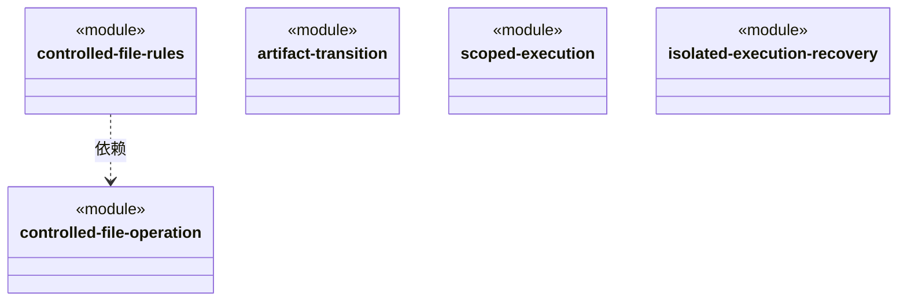

# src/logic/file-operations/rules 架构

## 设计意图

定义受控文件操作、隔离执行及其恢复的纯协议和不变量，统一实时提交与历史核验。

操作身份、指纹、不可变阶段和公开摘要分别由相应规则表达；产物删除/移动证明必须关联原清单和真实阶段。规则不进行平台 I/O，也不因输入结构合法就签发权限；服务与运行能力负责取得可信授权。

## 主要组成

| 组成 | 定位 |
| --- | --- |
| [controlled-file-operation](controlled-file-operation.ts) | 受控单文件写入、原操作报告和本机补偿的公共纯协议，供运行时与 Bridge 共用。 |
| [controlled-file-rules](controlled-file-rules.ts) | 统一受控写与补偿的稳定身份、指纹、阶段回执及公共摘要投影。 |
| [artifact-transition](artifact-transition.ts) | 受控产物删除/移动的严格输入、原操作阶段和可公开证明协议，供运行、清单及界面共用。 |
| [scoped-execution](scoped-execution.ts) | 冻结范围成员的受控读取与固定 Node 执行协议，供 Runtime 和平台共享。 |
| [isolated-execution-recovery](isolated-execution-recovery.ts) | 隔离执行的可信调用授权与桌面核实、清理公开协议。 |

<!-- architecture:generated:start -->

## 架构关系

[上层设计](../ARCHITECTURE.md)

<!-- architecture:generated:end -->
