# src/logic/file-operations/rules 架构

本目录只维护这一份说明。设计与契约直接编辑本文；文件清单、类图和导航由 [架构脚本](../../../../scripts/source-architecture.mjs) 更新，生成区域之外的人工说明会保留。

## 封装意图

受控文件操作和隔离执行的冻结协议、规则与恢复状态。平台副作用经端口实现，不因物理目录聚合改变授权、路径校验或证据效力。

## 类与模块的设计意图

下表依据源码声明及文件头说明定位封装。字段表示该实例持有的状态或协作引用，不表示它拥有被引用服务的生命周期；实际资源责任和调用限制见下文契约及源码注释。

| 类／模块 | 实现形式与实例字段 | 封装依据 |
| --- | --- | --- |
| [artifact-transition-evidence.ts](artifact-transition-evidence.ts) | 函数／契约模块 | 前态必须早于原调用，后态须恰好对应声明操作；其它副作用、重规划或内容变化不能沿用旧操作。 |
| [artifact-transition.ts](artifact-transition.ts) | 函数／契约模块 | 先前缺失观察不能补造操作；原清单、独占句柄字节、可靠执行顺序和两端结果须分别保留。 |
| [controlled-file-event.ts](controlled-file-event.ts) | 函数／契约模块 | 实际字节与 Win32 句柄由 Main 持有；唯一 Store 只验证可信事实和阶段链，不将备份路径或正文公开。 |
| [controlled-file-invariants.ts](controlled-file-invariants.ts) | 函数／契约模块 | 每次仅保存一条不可变阶段，不与任务图混写；文件 IO 在 Store 外，终态必须保留已执行事实而不能被停止或今日配置变化抹掉。 |
| [controlled-file-operation.ts](controlled-file-operation.ts) | 函数／契约模块 | 只公开身份与字节摘要，真实备份和平台文件身份留在私有事件；applied 只证明操作事实，不是业务验收。ledger 纯契约供影响观察复用，查询时钟不进入处置依据。 |
| [controlled-file-rules.ts](controlled-file-rules.ts) | 函数／契约模块 | Main 与 Store 共用唯一算法；新协议 Schema 固定字段顺序，旧领域命令算法不受影响。 |
| [isolated-execution-recovery.ts](isolated-execution-recovery.ts) | 函数／契约模块 | 界面只能选择原运行和执行记录，不能传入路径、PID、profile 或重新执行参数。 |
| [scoped-execution.ts](scoped-execution.ts) | 函数／契约模块 | 只允许模型选择原范围内文件和有界参数；运行身份、预算、执行器及环境均由可信工厂捕获。 |

## 接口设计契约

<a id="contract"></a>

递归业务受控写入从 agentBusinessRuns 核对活动身份、原周期及冻结知识；补偿仍要求原运行关闭。controlled-file-invariants 不把登记 active 当作写入成功。

## 开闭边界

本目录的职责及允许协作由[封装意图](#封装意图)限定，输入输出、状态与失败语义以[接口设计契约](#接口设计契约)为准。扩展从已有公开入口及实际装配位置进入；没有明确可替换契约的部分按真实影响修改和验证，不预建未使用的基类或插件入口。

<!-- architecture:generated:start -->

## 文件清单

| 文件 | 形式 | 当前职责 |
| --- | --- | --- |
| [ARCHITECTURE.md](ARCHITECTURE.md) | 说明文档 | 本目录的文件清单、真实声明、依赖与子封装导航。 |
| [artifact-transition-evidence.ts](artifact-transition-evidence.ts) | 源码模块 | 从原完整清单、实际操作阶段与成功工具回执重建文件删除/移动证明，供采集及验收共用。 |
| [artifact-transition.ts](artifact-transition.ts) | 源码模块 | 受控产物删除/移动的严格输入、原操作阶段和可公开证明协议，供运行、清单及界面共用。 |
| [controlled-file-event.ts](controlled-file-event.ts) | 源码模块 | 保存受控文件操作的私有来源、备份引用及不可变阶段事件。 |
| [controlled-file-invariants.ts](controlled-file-invariants.ts) | 源码模块 | 唯一派发 Store 在提交及重放时校验受控文件附录的身份、阶段、回执和容量。 |
| [controlled-file-operation.ts](controlled-file-operation.ts) | 源码模块 | 受控单文件写入、原操作报告和本机补偿的公共纯协议，供运行时与 Bridge 共用。 |
| [controlled-file-rules.ts](controlled-file-rules.ts) | 源码模块 | 统一受控写与补偿的稳定身份、指纹、阶段回执及公共摘要投影。 |
| [isolated-execution-recovery.ts](isolated-execution-recovery.ts) | 源码模块 | 隔离执行的可信调用授权与桌面核实、清理公开协议。 |
| [scoped-execution.ts](scoped-execution.ts) | 源码模块 | 冻结范围成员的受控读取与固定 Node 执行协议，供 Runtime 和平台共享。 |

## 架构类图

成员标记：`+` 公开、`-` 私有、`#` 受保护、`$` 静态；`function` 为函数值成员，`get`／`set` 为访问器。调用／构造／索引签名按匿名签名列出，不虚构方法名；`global.` 表示全局声明补充，非运行时嵌套类。构造函数单独列出，运行时私有字段保留 `#`。文档和资源仅在文件清单中导航，不作为代码节点。

### artifact-transition-evidence.ts

[查看源码](artifact-transition-evidence.ts)。

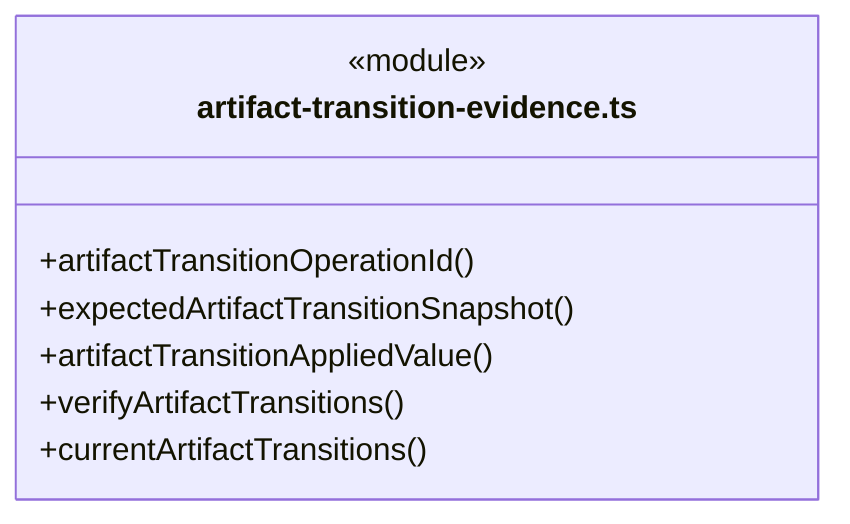

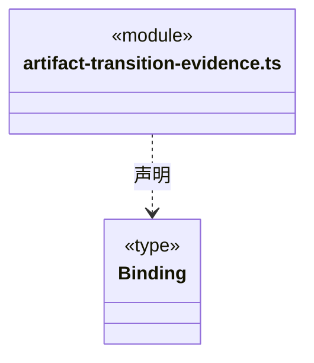

直接依赖：[../../../core/platform/node/serialization.ts](../../../core/platform/node/serialization.ts)、[../../evidence/rules/artifact-evidence.ts](../../evidence/rules/artifact-evidence.ts)、[../../evidence/rules/output-manifest-identity.ts](../../evidence/rules/output-manifest-identity.ts)、[../../evidence/rules/output-manifest.ts](../../evidence/rules/output-manifest.ts)、[artifact-transition.ts](artifact-transition.ts)、[../../workspace/rules/artifact-scope.ts](../../workspace/rules/artifact-scope.ts)。

### artifact-transition.ts

[查看源码](artifact-transition.ts)。

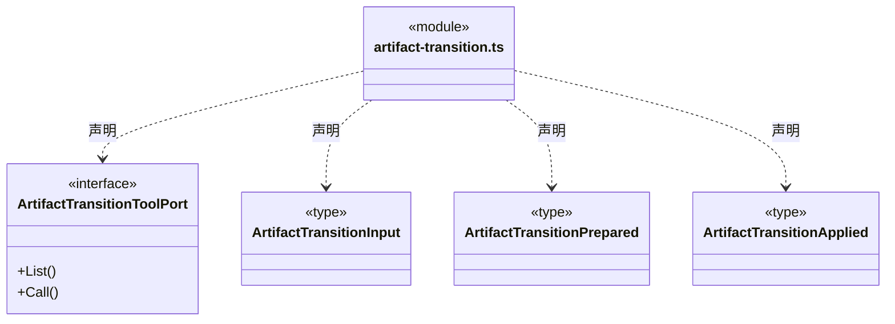

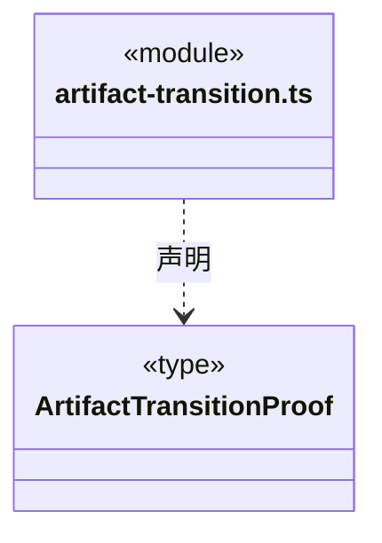

直接依赖：[../../evidence/rules/artifact-baseline.ts](../../evidence/rules/artifact-baseline.ts)、[../../workspace/rules/artifact-scope.ts](../../workspace/rules/artifact-scope.ts)。

### controlled-file-event.ts

[查看源码](controlled-file-event.ts)。

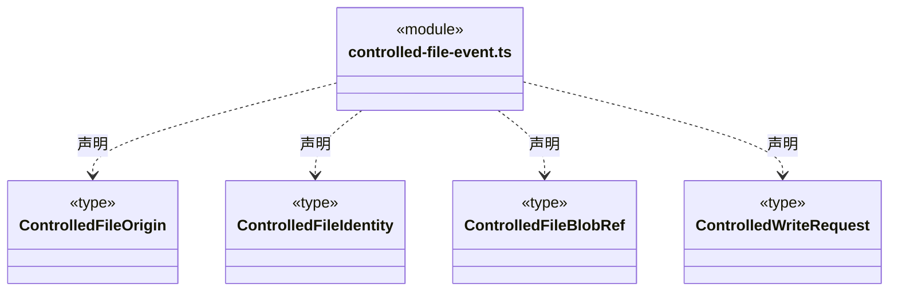

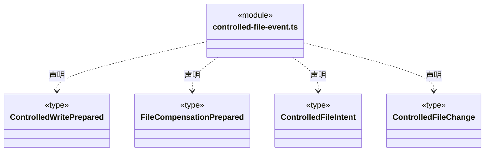

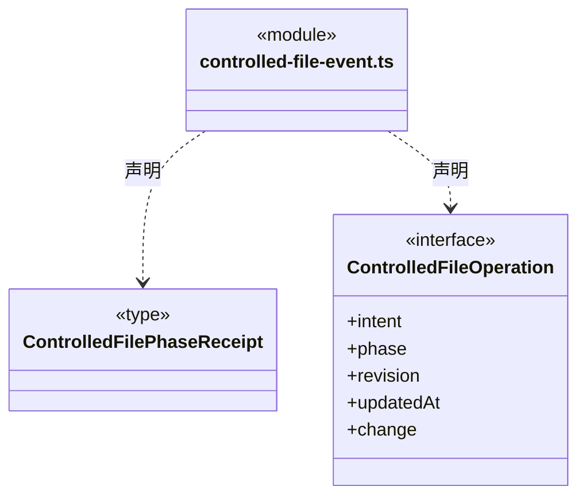

直接依赖：[controlled-file-operation.ts](controlled-file-operation.ts)。

### controlled-file-invariants.ts

[查看源码](controlled-file-invariants.ts)。

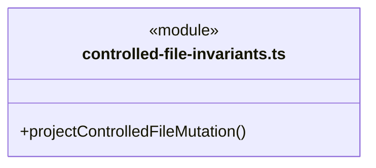

直接依赖：[../../../core/errors.ts](../../../core/errors.ts)、[../../dispatch/rules/dispatch-storage.ts](../../dispatch/rules/dispatch-storage.ts)、[controlled-file-event.ts](controlled-file-event.ts)、[controlled-file-operation.ts](controlled-file-operation.ts)、[controlled-file-rules.ts](controlled-file-rules.ts)。

### controlled-file-operation.ts

[查看源码](controlled-file-operation.ts)。

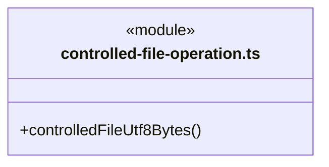

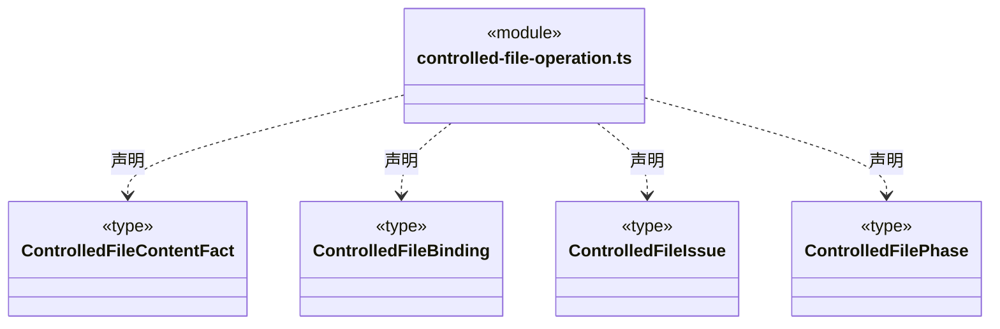

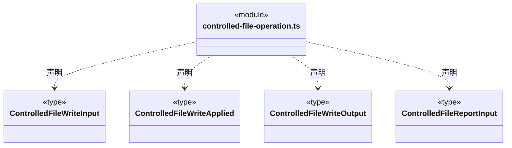

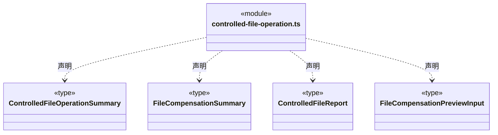

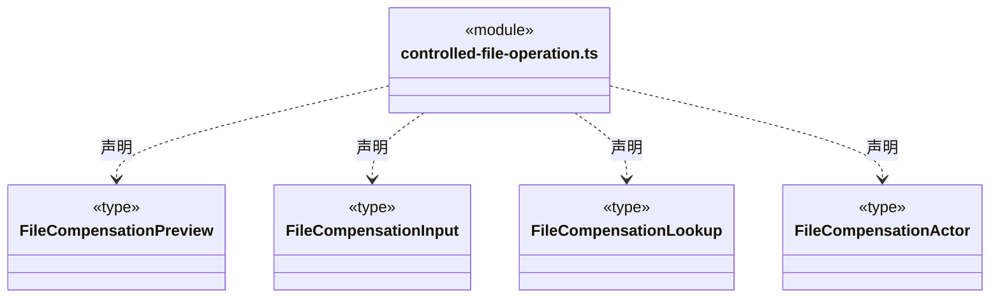

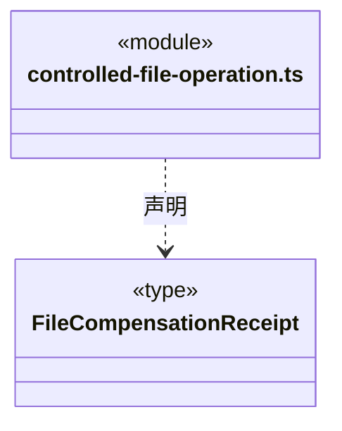


### controlled-file-rules.ts

[查看源码](controlled-file-rules.ts)。

公开入口 1/2（同一模块）。

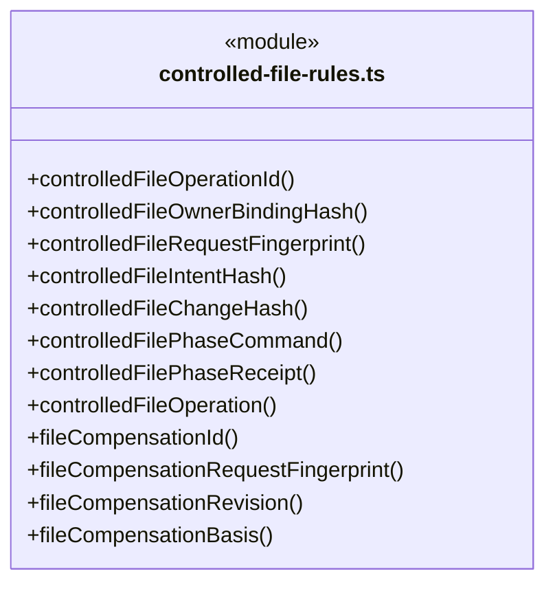

公开入口 2/2（同一模块）。

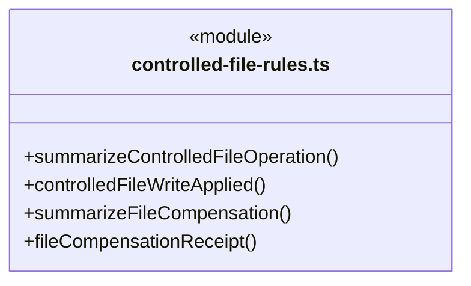

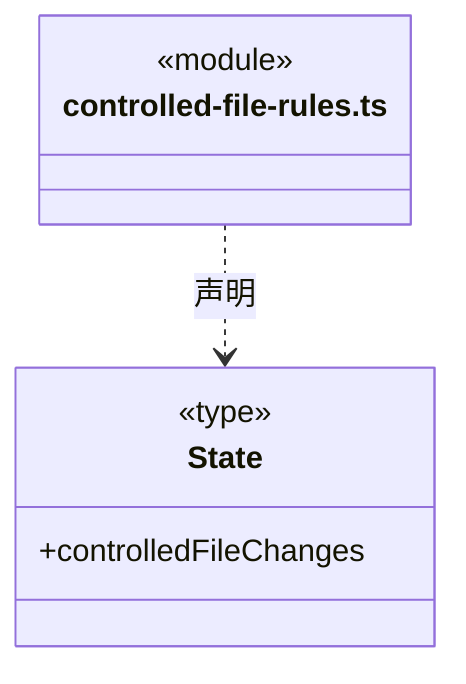

直接依赖：[../../../core/errors.ts](../../../core/errors.ts)、[../../../core/platform/node/serialization.ts](../../../core/platform/node/serialization.ts)、[controlled-file-event.ts](controlled-file-event.ts)、[controlled-file-operation.ts](controlled-file-operation.ts)、[../../team/rules/automatic-execution.ts](../../team/rules/automatic-execution.ts)、[../../team/rules/member-execution-binding.ts](../../team/rules/member-execution-binding.ts)。

### isolated-execution-recovery.ts

[查看源码](isolated-execution-recovery.ts)。

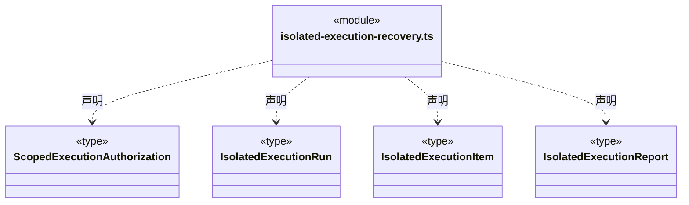

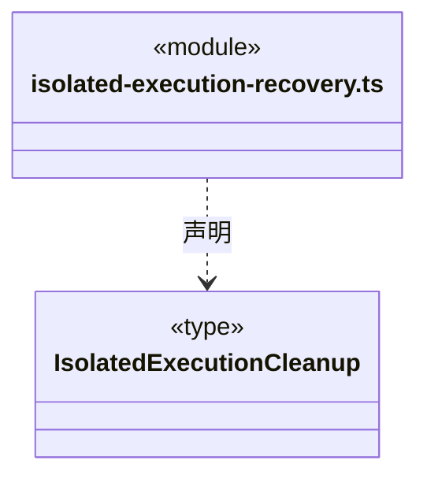


### scoped-execution.ts

[查看源码](scoped-execution.ts)。

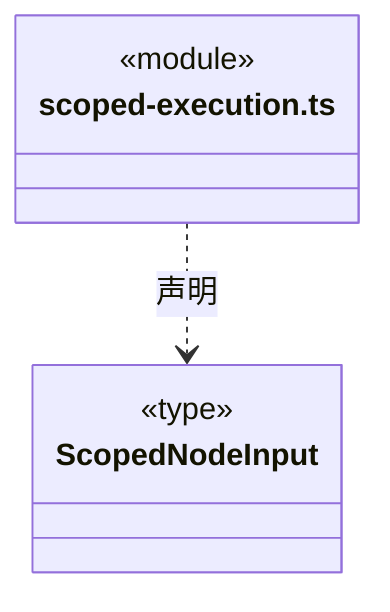

直接依赖：[../../workspace/rules/execution-scope.ts](../../workspace/rules/execution-scope.ts)。

### 本目录调用边界

```mermaid
classDiagram
class N_src_logic_file_operations_rules_artifact_transition_evidence_ts["artifact-transition-evidence.ts"] {
  <<module>>
}
class N_src_logic_file_operations_rules_artifact_transition_ts["artifact-transition.ts"] {
  <<module>>
}
class N_src_logic_file_operations_rules_controlled_file_event_ts["controlled-file-event.ts"] {
  <<module>>
}
class N_src_logic_file_operations_rules_controlled_file_operation_ts["controlled-file-operation.ts"] {
  <<module>>
}
class N_src_logic_file_operations_rules_controlled_file_invariants_ts["controlled-file-invariants.ts"] {
  <<module>>
}
N_src_logic_file_operations_rules_artifact_transition_evidence_ts ..> N_src_logic_file_operations_rules_artifact_transition_ts : 导入依赖
N_src_logic_file_operations_rules_controlled_file_event_ts ..> N_src_logic_file_operations_rules_controlled_file_operation_ts : 导入依赖
N_src_logic_file_operations_rules_controlled_file_invariants_ts ..> N_src_logic_file_operations_rules_controlled_file_event_ts : 导入依赖
N_src_logic_file_operations_rules_controlled_file_invariants_ts ..> N_src_logic_file_operations_rules_controlled_file_operation_ts : 导入依赖
```

```mermaid
classDiagram
class N_src_logic_file_operations_rules_controlled_file_invariants_ts["controlled-file-invariants.ts"] {
  <<module>>
}
class N_src_logic_file_operations_rules_controlled_file_rules_ts["controlled-file-rules.ts"] {
  <<module>>
}
class N_src_logic_file_operations_rules_controlled_file_event_ts["controlled-file-event.ts"] {
  <<module>>
}
class N_src_logic_file_operations_rules_controlled_file_operation_ts["controlled-file-operation.ts"] {
  <<module>>
}
N_src_logic_file_operations_rules_controlled_file_invariants_ts ..> N_src_logic_file_operations_rules_controlled_file_rules_ts : 导入依赖
N_src_logic_file_operations_rules_controlled_file_rules_ts ..> N_src_logic_file_operations_rules_controlled_file_event_ts : 导入依赖
N_src_logic_file_operations_rules_controlled_file_rules_ts ..> N_src_logic_file_operations_rules_controlled_file_operation_ts : 导入依赖
```


## 子目录导航

无子目录。

[返回上层](../ARCHITECTURE.md)。

每次修改本目录代码，同步维护文件头、关键契约说明及本图。未实现的治理、证据验收和自动编排能力不列入当前类图。

<!-- architecture:generated:end -->
