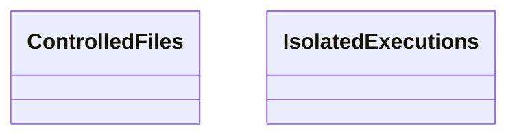

# src/logic/file-operations/service 架构

## 设计意图

受控文件操作与隔离执行的应用服务，连接冻结授权、工作区身份与 platform 实现；不把底层完成当业务验收。 所有受控文件与删除/移动操作继续拒绝安装、用户及独立 R/E 缓存根。

## 主要组成

| 组成 | 定位 |
| --- | --- |
| [ControlledFiles](controlled-files.ts) | 已打开工作区的受控写入与桌面补偿服务，连接运行许可、私有备份、独占子进程和唯一 DispatchStore。 |
| [IsolatedExecutions](isolated-executions.ts) | 正式成员隔离记录的可信装配，以及原运行的桌面核实／显式清理服务。 |

<!-- architecture:generated:start -->

## 架构关系

[上层设计](../ARCHITECTURE.md)

<!-- architecture:generated:end -->
