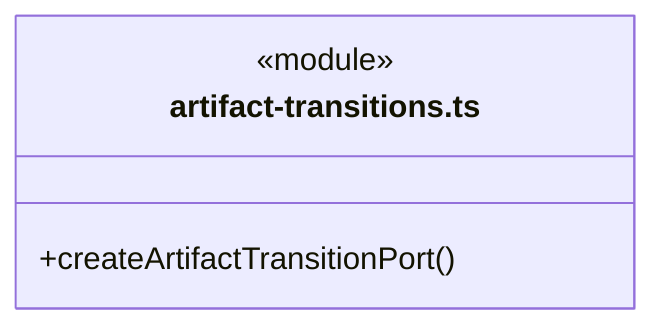
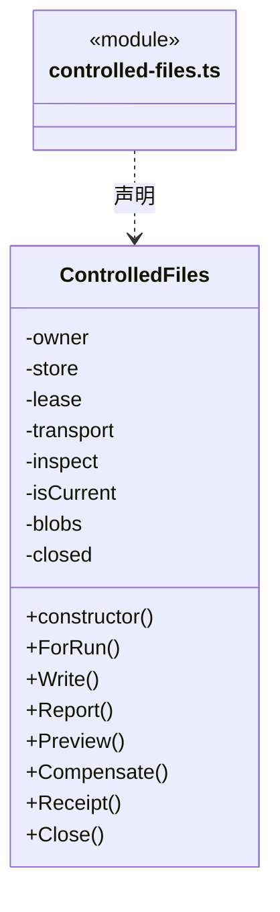
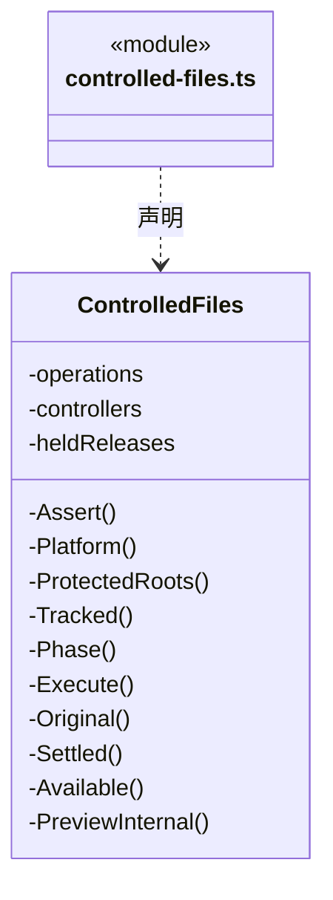
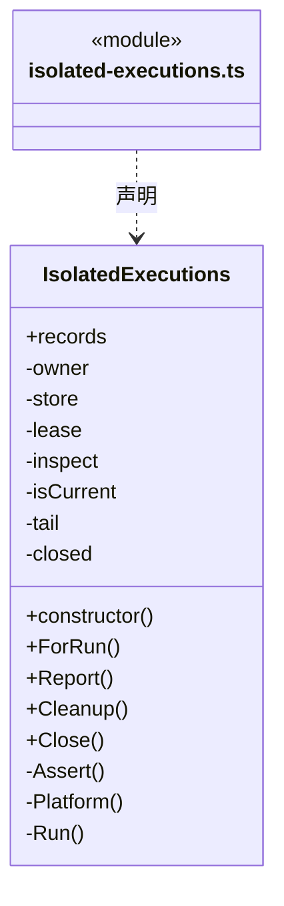
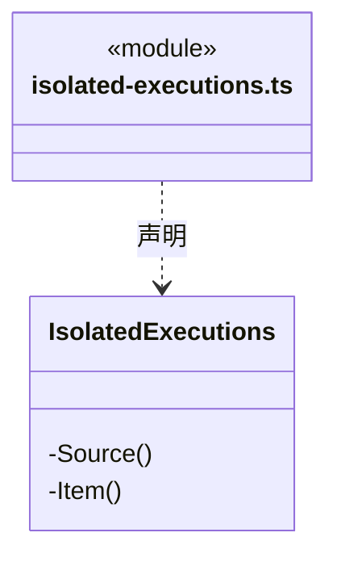

# src/logic/file-operations/service 架构

本目录只维护这一份说明。设计与契约直接编辑本文；文件清单、类图和导航由 [架构脚本](../../../../scripts/source-architecture.mjs) 更新，生成区域之外的人工说明会保留。

## 封装意图

受控文件操作与隔离执行的应用服务，连接冻结授权、工作区身份与 platform 实现；不把底层完成当业务验收。 所有受控文件与删除/移动操作继续拒绝安装、用户及独立 R/E 缓存根。

## 类与模块的设计意图

下表依据源码声明及文件头说明定位封装。字段表示该实例持有的状态或协作引用，不表示它拥有被引用服务的生命周期；实际资源责任和调用限制见下文契约及源码注释。

| 类／模块 | 实现形式与实例字段 | 封装依据 |
| --- | --- | --- |
| [artifact-transitions.ts](artifact-transitions.ts) | 函数／契约模块 | 原阶段由可信 Runtime canonical 保存，Main 只核工作区生命周期、固定根及真实工人返回；无能力不能回退任意文件命令。 |
| [ControlledFiles](controlled-files.ts) | 实例类；持有 `blobs`、`closed`、`operations`、`controllers`、`heldReleases`、`owner`、`store`、`lease`、`transport`、`inspect`、`isCurrent` | 仅 Main 实际装配实例；没有 utility 传输时查询历史仍可用，新写和补偿明确拒绝。 |
| [IsolatedExecutions](isolated-executions.ts) | 实例类；持有 `records`、`tail`、`closed`、`owner`、`store`、`lease`、`inspect`、`isCurrent` | 每个已打开工作区唯一实例；由工作区锁保护跨进程写入，显式清理在本实例串行。 |

## 接口设计契约

### 受控文件的服务关闭边界

ControlledFiles 的 operations 组合 utility.InFlightOperations，只跟踪原操作 Promise；controllers、closed、heldReleases 仍由服务维护。关闭先拒绝新业务并撤销原控制器，再等待当前操作集合、核实平台 transport.drain，最后释放原租约。排空失败不跳过平台核实或释放屏障。

对象身份、字节备份、阶段账本、一次授权、补偿预览与显式提交保留在本目录及 Core 原契约中。基础集合不发起文件操作，不创建重试/恢复或全局共享状态。

#### 递归业务来源

受控写入、报告、显式补偿和隔离报告同时接受旧 DispatchRun 与已登记 AgentBusinessRun 的最小 BusinessRunSource。新记录以 protocol 固定原日志位置；不得凭模型给出的 runId 或目录读取任意日志。active 登记视为在途，禁止提前补偿；closed 后仍必须满足原文件阶段、canonical、工作区和精确字节检查。

隔离报告读取真实宿主／Job／目录状态，重启后即时 host、job 及 basis 可以变化，持久 executionId、原授权和清理阶段不变。查询不回写旧记录，也不重放隔离程序。

## 开闭边界

本目录的职责及允许协作由[封装意图](#封装意图)限定，输入输出、状态与失败语义以[接口设计契约](#接口设计契约)为准。扩展从已有公开入口及实际装配位置进入；没有明确可替换契约的部分按真实影响修改和验证，不预建未使用的基类或插件入口。

<!-- architecture:generated:start -->

## 文件清单

| 文件 | 形式 | 当前职责 |
| --- | --- | --- |
| [ARCHITECTURE.md](ARCHITECTURE.md) | 说明文档 | 本目录的文件清单、真实声明、依赖与子封装导航。 |
| [artifact-transitions.ts](artifact-transitions.ts) | 源码模块 | 把已打开工作区的真实文件 utility 能力装配为成员删除/移动端口，不暴露平台句柄到 Core。 |
| [controlled-files.ts](controlled-files.ts) | 源码模块 | 已打开工作区的受控写入与桌面补偿服务，连接运行许可、私有备份、独占子进程和唯一 DispatchStore。 |
| [isolated-executions.ts](isolated-executions.ts) | 源码模块 | 正式成员隔离记录的可信装配，以及原运行的桌面核实／显式清理服务。 |

## 架构类图

成员标记：`+` 公开、`-` 私有、`#` 受保护、`$` 静态；构造函数单独列出。文档和资源仅在文件清单中导航，不作为代码节点。

### artifact-transitions.ts

直接依赖：[../../../core/errors.ts](../../../core/errors.ts)、[../../execution/rules/capabilities/run-artifact-transition.ts](../../execution/rules/capabilities/run-artifact-transition.ts)、[../platform/files/controlled-file-protocol.ts](../platform/files/controlled-file-protocol.ts)、[../../workspace/service/workspace.ts](../../workspace/service/workspace.ts)。

### controlled-files.ts

成员 1/2（同名节点为同一声明，跨图合并阅读）。

成员 2/2（同名节点为同一声明，跨图合并阅读）。

直接依赖：[../../../core/utility/index.ts](../../../core/utility/index.ts)、[../../../core/errors.ts](../../../core/errors.ts)、[../../../core/platform/node/serialization.ts](../../../core/platform/node/serialization.ts)、[../../workspace/service/workspace.ts](../../workspace/service/workspace.ts)、[../../dispatch/rules/dispatch-storage.ts](../../dispatch/rules/dispatch-storage.ts)、[../../execution/rules/business-run.ts](../../execution/rules/business-run.ts)、[../../execution/rules/types.ts](../../execution/rules/types.ts)、[../../execution/rules/capabilities/run-controlled-file.ts](../../execution/rules/capabilities/run-controlled-file.ts)、[../rules/controlled-file-operation.ts](../rules/controlled-file-operation.ts)、[../rules/controlled-file-event.ts](../rules/controlled-file-event.ts)、[../rules/controlled-file-rules.ts](../rules/controlled-file-rules.ts)、[../rules/controlled-file-invariants.ts](../rules/controlled-file-invariants.ts)、[../platform/files/controlled-file-blobs.ts](../platform/files/controlled-file-blobs.ts)、[../platform/files/controlled-file-protocol.ts](../platform/files/controlled-file-protocol.ts)、[../../execution/admission/workspace-lease.ts](../../execution/admission/workspace-lease.ts)。

### isolated-executions.ts

成员 1/2（同名节点为同一声明，跨图合并阅读）。

成员 2/2（同名节点为同一声明，跨图合并阅读）。

直接依赖：[../../../core/platform/node/serialization.ts](../../../core/platform/node/serialization.ts)、[../../../core/errors.ts](../../../core/errors.ts)、[../../dispatch/rules/dispatch-storage.ts](../../dispatch/rules/dispatch-storage.ts)、[../../execution/rules/business-run.ts](../../execution/rules/business-run.ts)、[../../execution/rules/types.ts](../../execution/rules/types.ts)、[../../workspace/rules/execution-scope.ts](../../workspace/rules/execution-scope.ts)、[../rules/scoped-execution.ts](../rules/scoped-execution.ts)、[../rules/isolated-execution-recovery.ts](../rules/isolated-execution-recovery.ts)、[../platform/isolation/isolation-record.ts](../platform/isolation/isolation-record.ts)、[../platform/isolation/isolation-records.ts](../platform/isolation/isolation-records.ts)、[../platform/isolation/isolation-recovery-win32.ts](../platform/isolation/isolation-recovery-win32.ts)、[../../workspace/service/workspace.ts](../../workspace/service/workspace.ts)、[../../execution/admission/workspace-lease.ts](../../execution/admission/workspace-lease.ts)。

## 子目录导航

无子目录。

[返回上层](../ARCHITECTURE.md)。

每次修改本目录代码，同步维护文件头、关键契约说明及本图。未实现的治理、证据验收和自动编排能力不列入当前类图。

<!-- architecture:generated:end -->
