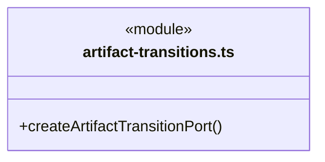
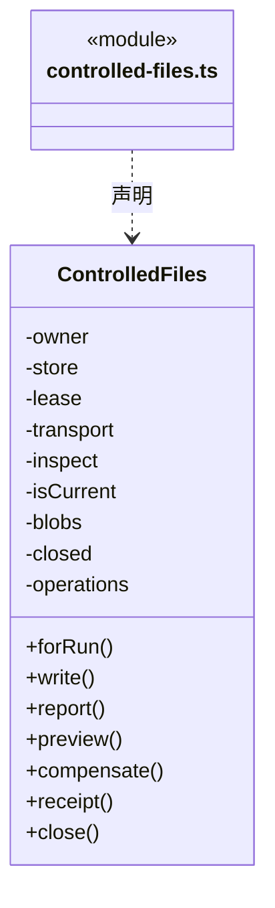
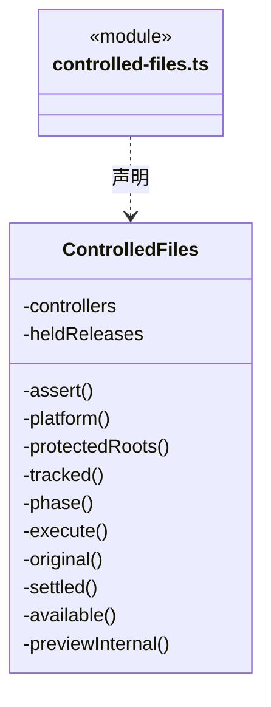
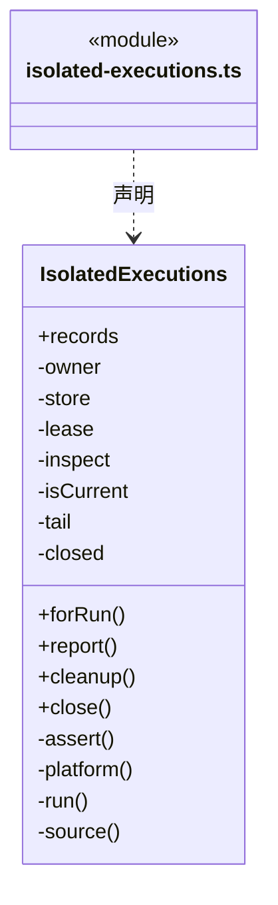
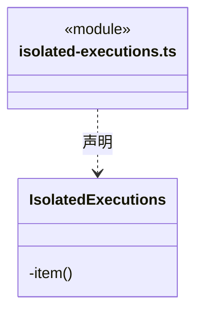

# src/logic/file-operations/service 架构

## 目录定位

受控文件操作与隔离执行的应用服务，连接冻结授权、工作区身份与 platform 实现；不把底层完成当业务验收。 所有受控文件与删除/移动操作继续拒绝安装、用户及独立 R/E 缓存根。

本文描述当前实现。通过分析目录边界后维护的 [源码架构脚本](../../../../scripts/source-architecture.mjs) 同步清单和声明；代码变更时仍须核对职责、关键成员与关系。

## 代码清单

| 文件 | 当前职责 |
| --- | --- |
| [artifact-transitions.ts](artifact-transitions.ts) | 把已打开工作区的真实文件 utility 能力装配为成员删除/移动端口，不暴露平台句柄到 Core。 |
| [controlled-files.ts](controlled-files.ts) | 已打开工作区的受控写入与桌面补偿服务，连接运行许可、私有备份、独占子进程和唯一 DispatchStore。 |
| [isolated-executions.ts](isolated-executions.ts) | 正式成员隔离记录的可信装配，以及原运行的桌面核实／显式清理服务。 |

## 架构类图

### artifact-transitions.ts

直接依赖：[../../../core/errors.ts](../../../core/errors.ts)、[../../execution/rules/capabilities/run-artifact-transition.ts](../../execution/rules/capabilities/run-artifact-transition.ts)、[../platform/files/controlled-file-protocol.ts](../platform/files/controlled-file-protocol.ts)、[../../workspace/service/workspace.ts](../../workspace/service/workspace.ts)。

### controlled-files.ts

成员 1/2（同名节点为同一声明，跨图合并阅读）。

成员 2/2（同名节点为同一声明，跨图合并阅读）。

直接依赖：[../../../core/utility/index.ts](../../../core/utility/index.ts)、[../../../core/errors.ts](../../../core/errors.ts)、[../../../core/platform/node/serialization.ts](../../../core/platform/node/serialization.ts)、[../../workspace/service/workspace.ts](../../workspace/service/workspace.ts)、[../../dispatch/rules/dispatch-storage.ts](../../dispatch/rules/dispatch-storage.ts)、[../../tasks/rules/dispatch-execution.ts](../../tasks/rules/dispatch-execution.ts)、[../../execution/rules/types.ts](../../execution/rules/types.ts)、[../../execution/rules/capabilities/run-controlled-file.ts](../../execution/rules/capabilities/run-controlled-file.ts)、[../rules/controlled-file-operation.ts](../rules/controlled-file-operation.ts)、[../rules/controlled-file-event.ts](../rules/controlled-file-event.ts)、[../rules/controlled-file-rules.ts](../rules/controlled-file-rules.ts)、[../rules/controlled-file-invariants.ts](../rules/controlled-file-invariants.ts)、[../platform/files/controlled-file-blobs.ts](../platform/files/controlled-file-blobs.ts)、[../platform/files/controlled-file-protocol.ts](../platform/files/controlled-file-protocol.ts)、[../../execution/admission/workspace-lease.ts](../../execution/admission/workspace-lease.ts)。

### isolated-executions.ts

成员 1/2（同名节点为同一声明，跨图合并阅读）。

成员 2/2（同名节点为同一声明，跨图合并阅读）。

直接依赖：[../../../core/platform/node/serialization.ts](../../../core/platform/node/serialization.ts)、[../../../core/errors.ts](../../../core/errors.ts)、[../../dispatch/rules/dispatch-storage.ts](../../dispatch/rules/dispatch-storage.ts)、[../../tasks/rules/dispatch-execution.ts](../../tasks/rules/dispatch-execution.ts)、[../../execution/rules/types.ts](../../execution/rules/types.ts)、[../../workspace/rules/execution-scope.ts](../../workspace/rules/execution-scope.ts)、[../rules/scoped-execution.ts](../rules/scoped-execution.ts)、[../rules/isolated-execution-recovery.ts](../rules/isolated-execution-recovery.ts)、[../platform/isolation/isolation-record.ts](../platform/isolation/isolation-record.ts)、[../platform/isolation/isolation-records.ts](../platform/isolation/isolation-records.ts)、[../platform/isolation/isolation-recovery-win32.ts](../platform/isolation/isolation-recovery-win32.ts)、[../../workspace/service/workspace.ts](../../workspace/service/workspace.ts)、[../../execution/admission/workspace-lease.ts](../../execution/admission/workspace-lease.ts)。

## 子目录导航

无子目录。

[返回上层](../ARCHITECTURE.md)。

每次修改本目录代码，同步维护文件头、关键契约说明及本图。未实现的治理、证据验收和自动编排能力不列入当前类图。

## 设计契约 v1 与落地范围

以下内容区分已接通能力与后续设计；以各节的实现状态为准，不将目标图当作现状图。维护源：[CONTRACT.md](CONTRACT.md)；生成类图时同步附加，勿直接修改本附录。

# 受控文件的服务关闭边界

ControlledFiles 的 operations 组合 utility.InFlightOperations，只跟踪原操作 Promise；controllers、closed、heldReleases 仍由服务维护。关闭先拒绝新业务并撤销原控制器，再等待当前操作集合、核实平台 transport.drain，最后释放原租约。排空失败不跳过平台核实或释放屏障。

对象身份、字节备份、阶段账本、一次授权、补偿预览与显式提交保留在本目录及 Core 原契约中。基础集合不发起文件操作，不创建重试/恢复或全局共享状态。
