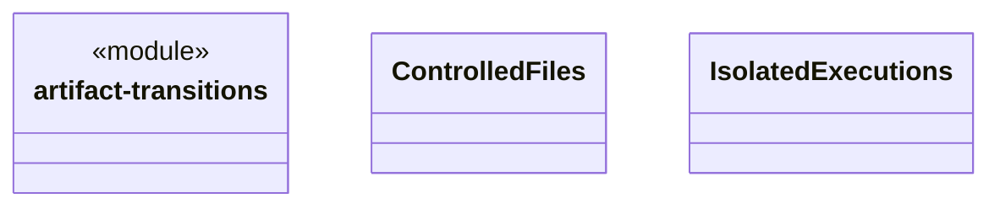

# src/logic/file-operations/service 架构

## 设计意图

将工作区身份、运行许可、持久记录与平台操作连接成可信文件用例。

`ControlledFiles` 协调受控写入和显式补偿，`IsolatedExecutions` 装配隔离记录及核实清理，`artifact-transitions` 提供删除/移动端口。服务复用唯一派发存储，拒绝安装、用户与独立资源／引擎缓存根；回包未知时沿原操作记录核实。

## 主要组成

| 组成 | 定位 |
| --- | --- |
| [ControlledFiles](controlled-files.ts) | 已打开工作区的受控写入与桌面补偿服务，连接运行许可、私有备份、独占子进程和唯一 DispatchStore。 |
| [IsolatedExecutions](isolated-executions.ts) | 正式成员隔离记录的可信装配，以及原运行的桌面核实／显式清理服务。 |
| [artifact-transitions](artifact-transitions.ts) | 将真实文件会话装配为成员删除/移动端口，不暴露平台句柄。 |

<!-- architecture:generated:start -->

## 架构关系

[上层设计](../ARCHITECTURE.md)

<!-- architecture:generated:end -->
