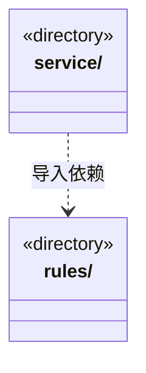

# src/logic/governance 架构

## 目录定位

模块治理、反馈及责任规则；服务与规则分开归属，实际依赖通过明确入口验证。

本文描述当前实现。通过分析目录边界后维护的 [源码架构脚本](../../../scripts/source-architecture.mjs) 同步清单和声明；代码变更时仍须核对职责、关键成员与关系。

## 代码清单

本层无直接代码文件。

## 架构类图

各图中的同名节点表示同一目录边界；跨组及完整直接依赖如下（无边不代表继承）：

- `service` → `rules`：导入。

## 子目录导航

- [rules/](rules/ARCHITECTURE.md)：模块知识治理的纯协议、保护规则与有界主工具投影。可信来源、冻结意见引用与本机评价独立于正式实施，旧意见替代不改历史，不把治理记录当业务验收。
- [service/](service/ARCHITECTURE.md)：工作区模块知识治理服务、可信桌面操作与独立主运行端口。登记保护、决定及实施只属桌面；模型仅可读取、观察、提案和核查回执；反馈来源在批准与实施前串行复核，未知不重放。

[返回上层](../ARCHITECTURE.md)。

每次修改本目录代码，同步维护文件头、关键契约说明及本图。未实现的治理、证据验收和自动编排能力不列入当前类图。
