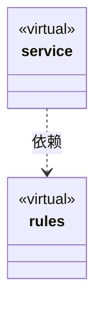

# src/logic/governance 架构

## 设计意图

封装业务模块正式知识的观察、提案、决定与实施。规则约束记录和门禁，服务协调可信来源及持久化；人工决定与模型建议保持独立。

## 主要组成

本层由下列子模块组合，每个子模块作为独立的虚拟类封装参与本层协作。

<!-- architecture:generated:start -->

## 架构关系

标注为 `virtual` 的节点是直接子模块的虚拟类封装；内部设计沿下方入口阅读。

## 子模块

| 虚拟封装 | 整体职责 |
| --- | --- |
| [rules](rules/ARCHITECTURE.md) | 定义模块知识治理的事实、反馈与实施条件。纯规则核对来源和决定，工具协议只提供有限的观察与提案能力，不直接写入正式知识。 |
| [service](service/ARCHITECTURE.md) | 把知识治理规则接到当前工作区和持久记录。治理服务统一协调提案、人工决定与实施，主运行适配只开放模型可用的窄端口，存储独立封装。 |

[上层设计](../ARCHITECTURE.md)

<!-- architecture:generated:end -->
