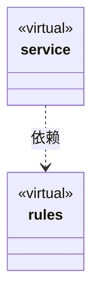

# src/logic/governance 架构

## 设计意图

组织正式模块知识的观察、提案、人工决定与实施，防止建议直接变成权威知识。

`rules` 约束来源、反馈及实施条件，`service` 接入工作区和持久化。模型可观察和提案，人工决定与正式实施分别保留独立事实；知识事务仍通过 knowledge 的提交边界执行。

## 主要组成

本层没有直接产品实现，由下方子模块组成；每个直接子模块作为一个虚拟封装，只在本层呈现整体职责与协作。

<!-- architecture:generated:start -->

## 架构关系

标注为 `virtual` 的节点是直接子模块的虚拟类封装；内部设计沿下方入口阅读。

## 子模块

| 虚拟封装 | 整体职责 |
| --- | --- |
| [rules](rules/ARCHITECTURE.md) | 表达模块知识治理的记录、反馈与写入条件，使建议、决定和实施可分别核对。 |
| [service](service/ARCHITECTURE.md) | 把治理规则连接到当前工作区及原始记录，统一协调观察、决定和正式实施。 |

[上层设计](../ARCHITECTURE.md)

<!-- architecture:generated:end -->
