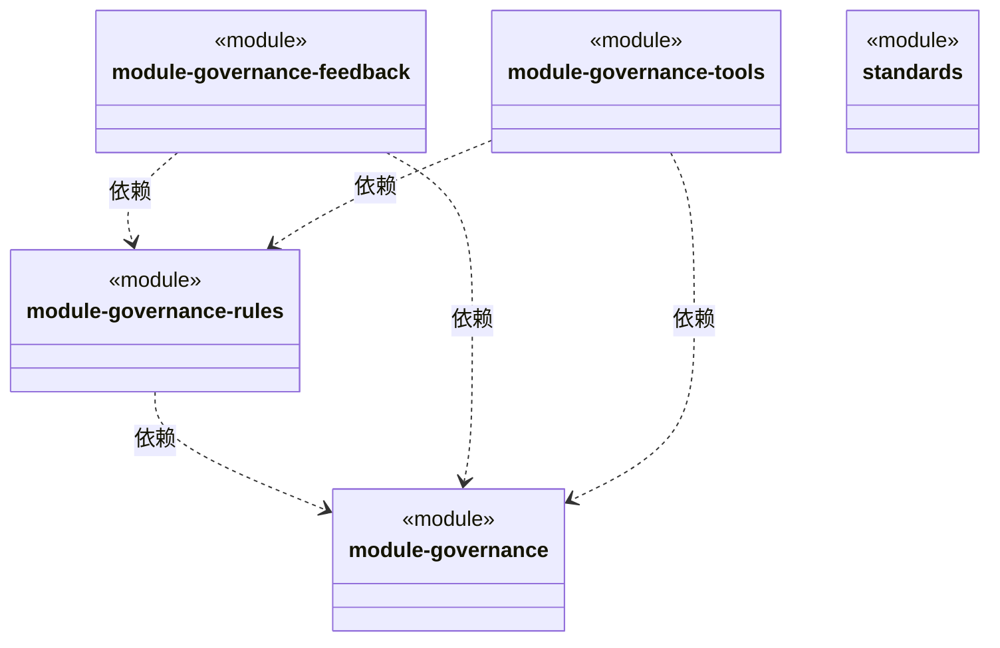

# src/logic/governance/rules 架构

## 设计意图

表达模块知识治理的记录、反馈与写入条件，使建议、决定和实施可分别核对。

`module-governance` 定义严格协议，规则与反馈函数核实来源和意见关系，工具协议仅开放有限观察与提案能力。`standards` 发布内置准则，不持有工作区状态或替代人工决定。

## 主要组成

| 组成 | 定位 |
| --- | --- |
| [standards](standards.ts) | 架构治理与认知交付的内置准则，供知识目录读取，不替代人工决策。 |
| [module-governance](module-governance.ts) | 单个 Module 正式知识治理的严格输入、不可变提案、本机决定及实施回执协议。 |
| [module-governance-rules](module-governance-rules.ts) | 模块知识治理的纯事实投影、提案依据、决定追加和知识写入门禁。 |
| [module-governance-feedback](module-governance-feedback.ts) | 核实新提案对原本机反馈的精确回应引用，并派生当前/已替代状态与逐项评价范围。 |
| [module-governance-tools](module-governance-tools.ts) | 主 Agent 治理工具的严格输入、真实来源端口和有界业务输出；不承载桌面批准或正式知识实施。 |

<!-- architecture:generated:start -->

## 架构关系

[上层设计](../ARCHITECTURE.md)

<!-- architecture:generated:end -->
