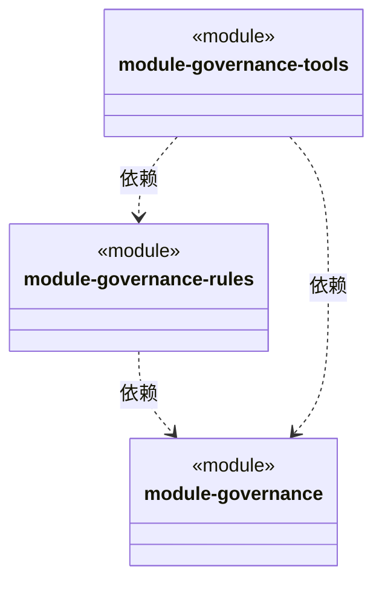

# src/logic/governance/rules 架构

## 设计意图

保存引擎工具所需的治理声明与纯规则。组织架构的实时修改和通知由 projects 模块负责，旧治理服务不再保留。

## 主要组成

| 组成 | 定位 |
| --- | --- |
| [module-governance-rules](module-governance-rules.ts) | 模块知识治理的纯事实投影、提案依据、决定追加和知识写入门禁。 |
| [module-governance-tools](module-governance-tools.ts) | 主 Agent 治理工具的严格输入、真实来源端口和有界业务输出；不承载桌面批准或正式知识实施。 |
| [module-governance](module-governance.ts) | 单个 Module 正式知识治理的严格输入、不可变提案、本机决定及实施回执协议。 |

<!-- architecture:generated:start -->

## 架构关系

[上层设计](../ARCHITECTURE.md)

<!-- architecture:generated:end -->
