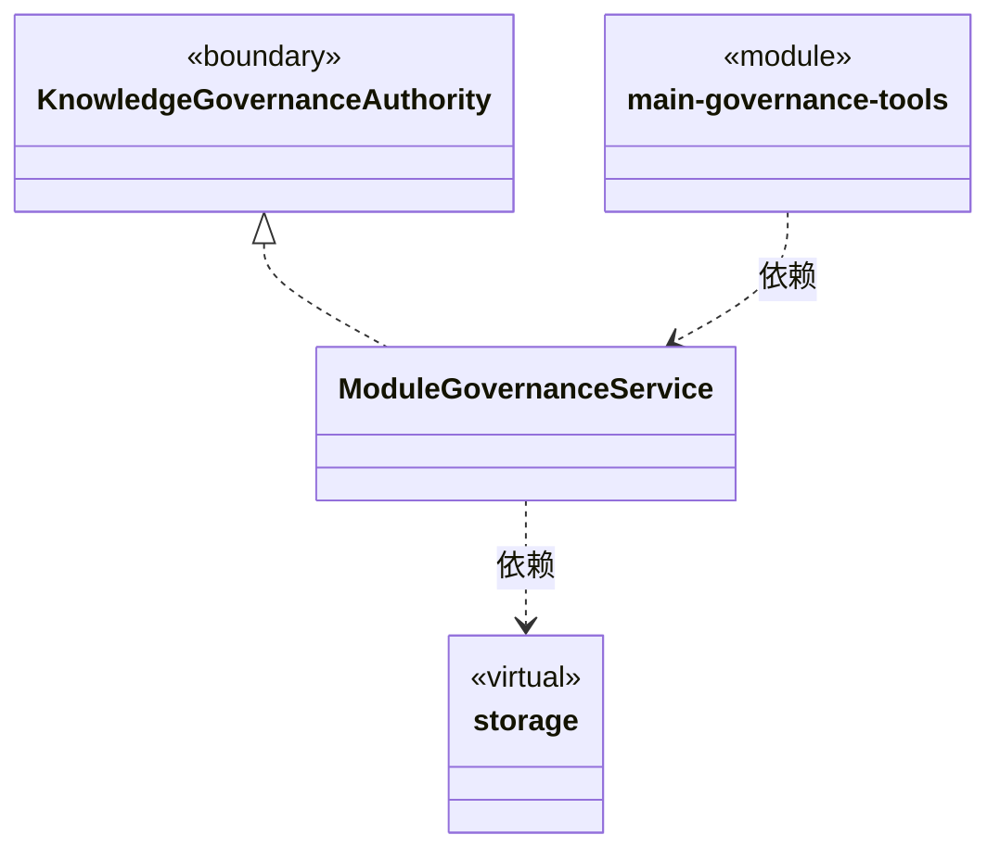

# src/logic/governance/service 架构

## 设计意图

把知识治理规则接到当前工作区和持久记录。治理服务统一协调提案、人工决定与实施，主运行适配只开放模型可用的窄端口，存储独立封装。

## 主要组成

| 组成 | 定位 |
| --- | --- |
| [ModuleGovernanceService](module-governance.ts) | 单模块治理服务，组织桌面保护与决定、可信主运行观察和提案、独立实施。 |
| [main-governance-tools](main-governance-tools.ts) | 把工作区治理服务绑定到一个真实主运行，提供模型专用的四个窄端口。 |

<!-- architecture:generated:start -->

## 架构关系

标注为 `virtual` 的节点是直接子模块的虚拟类封装；内部设计沿下方入口阅读。

外部继承／实现边界：[KnowledgeGovernanceAuthority](../../knowledge/storage/governance-port.ts)。

## 子模块

| 虚拟封装 | 整体职责 |
| --- | --- |
| [storage](storage/ARCHITECTURE.md) | 知识治理记录的物理持久化；业务规则和不可变意见契约在 logic/governance/rules，应用治理服务在父目录。 |

[上层设计](../ARCHITECTURE.md)

<!-- architecture:generated:end -->
