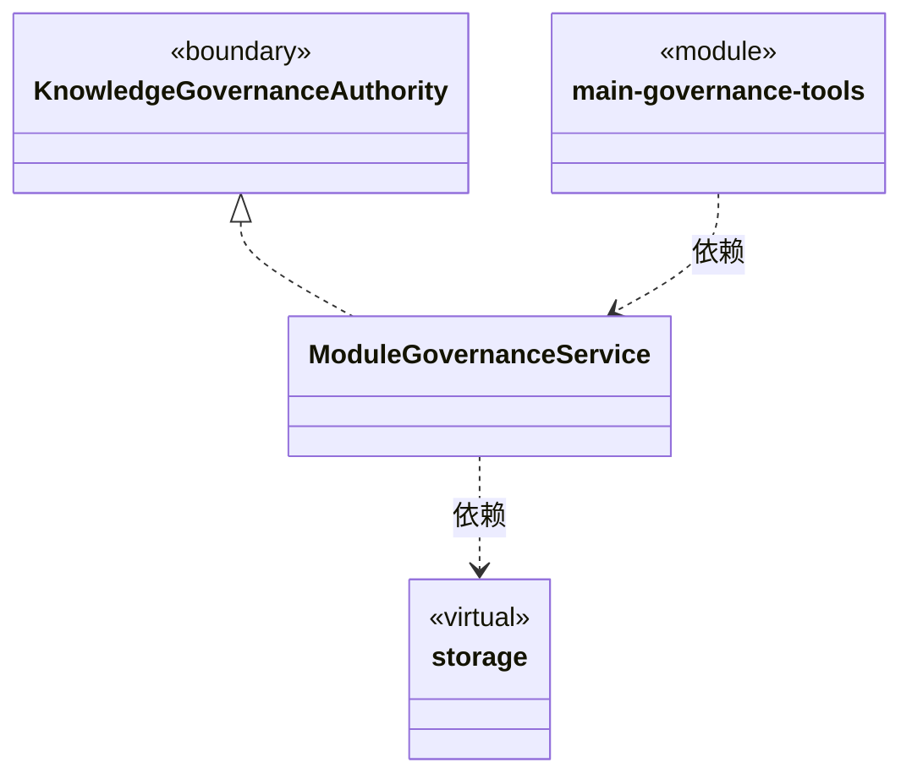

# src/logic/governance/service 架构

## 设计意图

把治理规则连接到当前工作区及原始记录，统一协调观察、决定和正式实施。

`ModuleGovernanceService` 核实工作区与治理记录后执行相应阶段，`main-governance-tools` 为真实主运行绑定窄端口；`storage` 保存不可变依据和实施意图。正式知识仍沿 knowledge 事务写入，模型工具不能越过本机决定直接实施。

## 主要组成

| 组成 | 定位 |
| --- | --- |
| [ModuleGovernanceService](module-governance.ts) | 单模块治理服务，组织桌面保护与决定、可信主运行观察和提案、独立实施。 |
| [main-governance-tools](main-governance-tools.ts) | 把工作区治理服务绑定到一个真实主运行，提供模型专用的四个窄端口。 |

## 现状与目标边界

当前 [module-governance.ts](module-governance.ts) 和 [main-governance-tools.ts](main-governance-tools.ts) 是本层直接实现，storage 已独立封装。目标是进一步明确用例协调与真实主运行适配的子边界，父层负责组合。迁移不能将治理记录持久化与正式知识提交误画为同一存储，也不能改变观察、人工决定和实施的权限区别。

<!-- architecture:generated:start -->

## 架构关系

标注为 `virtual` 的节点是直接子模块的虚拟类封装；内部设计沿下方入口阅读。

外部继承／实现边界：[KnowledgeGovernanceAuthority](../../knowledge/storage/governance-port.ts)。

## 子模块

| 虚拟封装 | 整体职责 |
| --- | --- |
| [storage](storage/ARCHITECTURE.md) | 持久保存工作区私有治理记录，使原提案、人工意见和实施意图在重启后仍可核实。 |

[上层设计](../ARCHITECTURE.md)

<!-- architecture:generated:end -->
