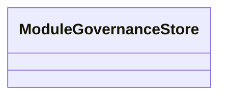

# src/logic/governance/service/storage 架构

## 设计意图

知识治理记录的物理持久化；业务规则和不可变意见契约在 logic/governance/rules，应用治理服务在父目录。

## 主要组成

| 组成 | 定位 |
| --- | --- |
| [ModuleGovernanceStore](module-governance-store.ts) | 保存工作区私有的保护登记、观察、提案、决定及原实施意图。 |

<!-- architecture:generated:start -->

## 架构关系

[上层设计](../ARCHITECTURE.md)

<!-- architecture:generated:end -->
