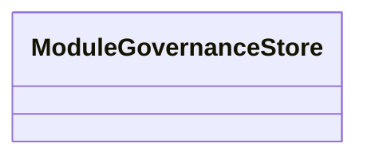

# src/logic/governance/service/storage 架构

## 设计意图

持久保存工作区私有治理记录，使原提案、人工意见和实施意图在重启后仍可核实。

`ModuleGovernanceStore` 负责记录的读写与完整性，治理条件由 rules 定义、用例由父层服务组织。这里不执行知识修改，也不把已保存意图当成实施完成。

## 主要组成

| 组成 | 定位 |
| --- | --- |
| [ModuleGovernanceStore](module-governance-store.ts) | 保存工作区私有的保护登记、观察、提案、决定及原实施意图。 |

<!-- architecture:generated:start -->

## 架构关系

[上层设计](../ARCHITECTURE.md)

<!-- architecture:generated:end -->
