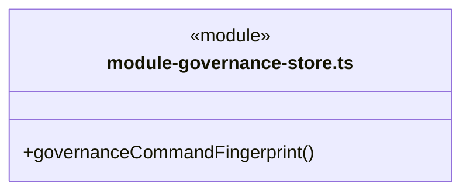
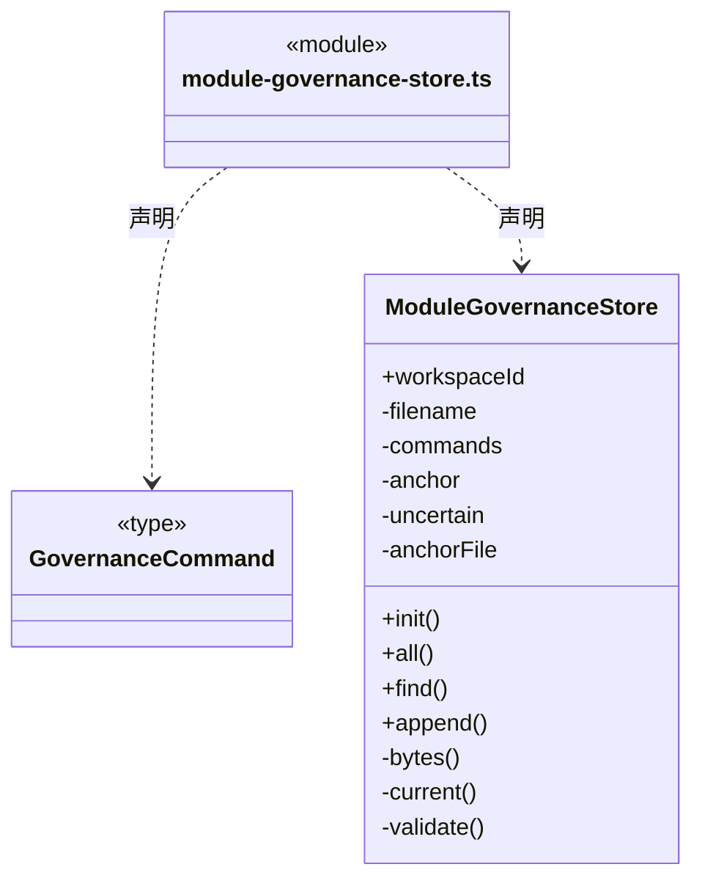

# src/logic/governance/service/storage 架构

## 目录定位

知识治理记录的物理持久化；业务规则和不可变意见契约在 logic/governance/rules，应用治理服务在父目录。

本文描述当前实现。通过分析目录边界后维护的 [源码架构脚本](../../../../../scripts/source-architecture.mjs) 同步清单和声明；代码变更时仍须核对职责、关键成员与关系。

## 代码清单

| 文件 | 当前职责 |
| --- | --- |
| [module-governance-store.ts](module-governance-store.ts) | 保存工作区私有的保护登记、观察、提案、决定及原实施意图。 |

## 架构类图

### module-governance-store.ts

直接依赖：[../../../../core/platform/node/files/index.ts](../../../../core/platform/node/files/index.ts)、[../../../../core/platform/node/serialization.ts](../../../../core/platform/node/serialization.ts)、[../../../../core/errors.ts](../../../../core/errors.ts)、[../../rules/module-governance.ts](../../rules/module-governance.ts)、[../../rules/module-governance-rules.ts](../../rules/module-governance-rules.ts)、[../../rules/module-governance-feedback.ts](../../rules/module-governance-feedback.ts)。

## 子目录导航

无子目录。

[返回上层](../ARCHITECTURE.md)。

每次修改本目录代码，同步维护文件头、关键契约说明及本图。未实现的治理、证据验收和自动编排能力不列入当前类图。

## 设计契约 v1 与落地范围

以下内容区分已接通能力与后续设计；以各节的实现状态为准，不将目标图当作现状图。维护源：[CONTRACT.md](CONTRACT.md)；生成类图时同步附加，勿直接修改本附录。

# 私有治理账本

每个工作区在用户数据目录保存 `governance/module-ledger.json`，不进入 `.cbim`、资源包或普通知识 CRUD。账本最多 512 条命令、32 MiB；超限拒绝新写，不裁剪历史。完整输入、稳定命令、回执及可选实施意图构成唯一追加链，加载时核身份、指纹、登记/观察/提案/决定顺序以及实施所引用的当时批准。

观察与提案可携带可信 origin，私有命令封装与公开记录必须逐字段一致，且参与原请求指纹。模型来源还须从工作区、根会话、run、toolCallId 与工具名重算相同命令 UUID；模型提案的原观察须属于同一主实例及逻辑通道。新桌面记录明确标注本机操作；旧记录缺省沿用旧指纹，不补造来源，不得冒领为模型调用。登记、决定和实施不接受模型 origin。

反馈、回应引用和评价同样是原命令/记录的一部分。新增提案按当前已见来源冻结 respondsTo，决定中的 feedback/assessments 须与原输入一致；批准、带评价的决定及实施意图在其出现时复核来源仍 current。加载完整账本按持久命令顺序核验，不拿末尾最新意见否认前面当时合法的记录。当前展示的 superseded 不写回历史；可选旧字段缺省不自动补空数组或 addressed。

`module-ledger.json.anchor` 绑定账本 UUID、命令数量及完整文件字节哈希。首次创建空账本和锚完成后才发布服务；旧锚存在但账本丢失、合法 JSON 被回退为空、删除完整分支或来源不一致都失败关闭，不能重新初始化为空保护。

写入顺序为锚 pending → 原子替换账本 → 确认锚 head。任一步失败，本实例拒绝继续读写治理或绕过知识门禁。重开只接受精确旧 head 或精确下一 pending：完成相应元数据确认，不执行知识事务。该协议没有承诺抵抗同时替换全部私有用户数据，也不把账本持久化称为跨存储原子知识提交。

存储不持有工作区、不自建回调队列。调用方负责持有 KnowledgeStore 串行屏障；落盘成功后才发布内存状态。实施结果不写入可自证成功的缓存，知识 journal 仍是唯一正式提交来源。
