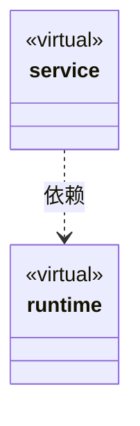

# src/logic/history 架构

## 设计意图

按主会话与角色读取运行履历的业务服务；日志事实与文件索引通过端口提供。

## 主要组成

本层由下列子模块组合，每个子模块作为独立的虚拟类封装参与本层协作。

<!-- architecture:generated:start -->

## 架构关系

标注为 `virtual` 的节点是直接子模块的虚拟类封装；内部设计沿下方入口阅读。

## 子模块

| 虚拟封装 | 整体职责 |
| --- | --- |
| [runtime](runtime/ARCHITECTURE.md) | 会话履历查询编排，依赖 logic/history/rules 履历契约，实际文件索引在 logic/history/service。 |
| [service](service/ARCHITECTURE.md) | 履历应用装配与文件索引。assembly.ts 连接角色/运行来源，file-store.ts 只实现 SessionHistoryStorage；文件存储不得反向依赖装配或工作区服务。 |

[上层设计](../ARCHITECTURE.md)

<!-- architecture:generated:end -->
