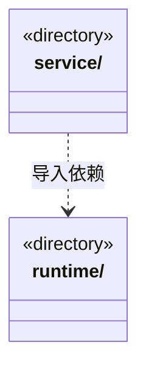

# src/logic/history 架构

## 目录定位

按主会话与角色读取运行履历的业务服务；日志事实与文件索引通过端口提供。

本文描述当前实现。通过分析目录边界后维护的 [源码架构脚本](../../../scripts/source-architecture.mjs) 同步清单和声明；代码变更时仍须核对职责、关键成员与关系。

## 代码清单

本层无直接代码文件。

## 架构类图

各图中的同名节点表示同一目录边界；跨组及完整直接依赖如下（无边不代表继承）：

- `service` → `runtime`：导入。

## 子目录导航

- [runtime/](runtime/ARCHITECTURE.md)：会话履历查询编排，依赖 Core 履历契约，实际文件索引在 main/history。
- [service/](service/ARCHITECTURE.md)：履历应用装配与文件索引。assembly.ts 连接角色/运行来源，file-store.ts 只实现 SessionHistoryStorage；文件存储不得反向依赖装配或工作区服务。

[返回上层](../ARCHITECTURE.md)。

每次修改本目录代码，同步维护文件头、关键契约说明及本图。未实现的治理、证据验收和自动编排能力不列入当前类图。
