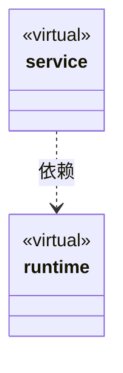

# src/logic/history 架构

## 设计意图

按静态角色和逻辑会话提供运行履历，保留实例退役之后仍可读取的历史事实。

`runtime` 组织只读索引和详情查询，`service` 将本机索引与可信日志读取接入。履历协议归 team 的角色领域，权威执行正文归 execution 日志；历史读取不创建运行或唤醒成员。

## 主要组成

本层没有直接产品实现，由下方子模块组成；每个直接子模块作为一个虚拟封装，只在本层呈现整体职责与协作。

<!-- architecture:generated:start -->

## 架构关系

标注为 `virtual` 的节点是直接子模块的虚拟类封装；内部设计沿下方入口阅读。

## 子模块

| 虚拟封装 | 整体职责 |
| --- | --- |
| [runtime](runtime/ARCHITECTURE.md) | 将已提交派发与执行日志投影为角色会话履历，隔离索引查询与真实运行。 |
| [service](service/ARCHITECTURE.md) | 把角色历史查询接到本机派生索引与固定运行目录，隔离文件实现和可信应用装配。 |

[上层设计](../ARCHITECTURE.md)

<!-- architecture:generated:end -->
