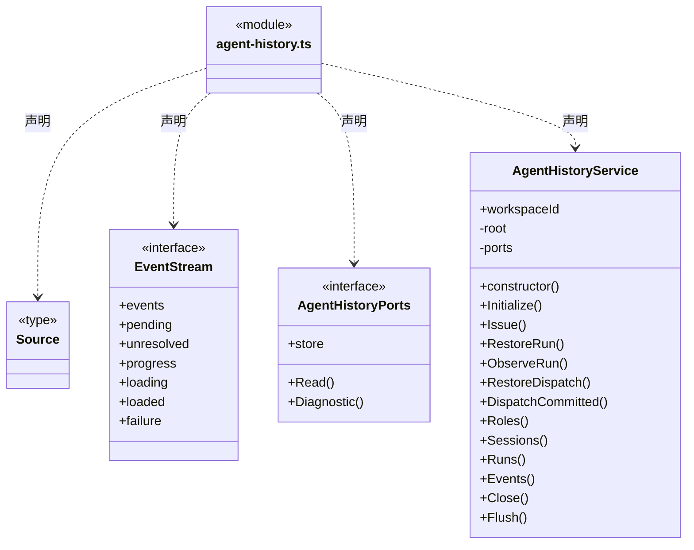
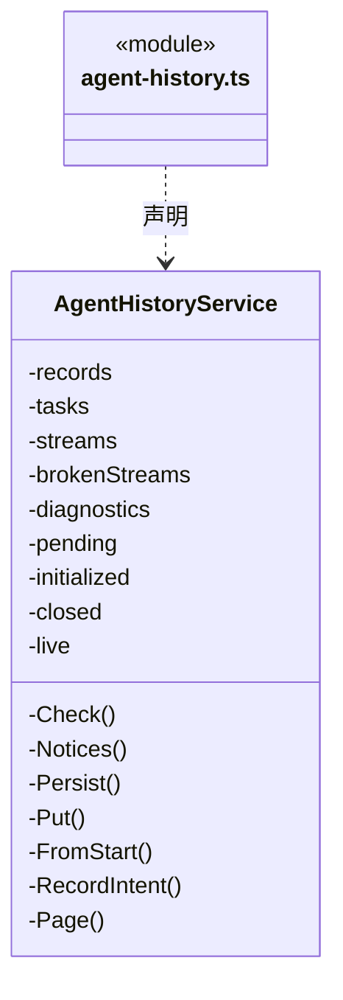
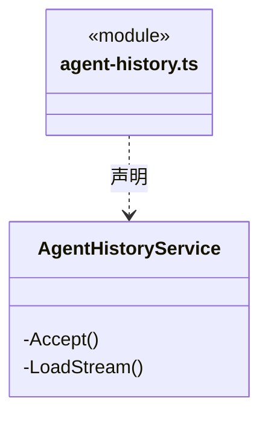

# src/logic/history/runtime 架构

本目录只维护这一份说明。设计与契约直接编辑本文；文件清单、类图和导航由 [架构脚本](../../../../scripts/source-architecture.mjs) 更新，生成区域之外的人工说明会保留。

## 封装意图

会话履历查询编排，依赖 logic/history/rules 履历契约，实际文件索引在 logic/history/service。

## 类与模块的设计意图

下表依据源码声明及文件头说明定位封装。字段表示该实例持有的状态或协作引用，不表示它拥有被引用服务的生命周期；实际资源责任和调用限制见下文契约及源码注释。

| 类／模块 | 实现形式与实例字段 | 封装依据 |
| --- | --- | --- |
| [AgentHistoryService](agent-history.ts) | 实例类；持有 `records`、`tasks`、`streams`、`brokenStreams`、`diagnostics`、`pending`、`initialized`、`closed`、`live`、`workspaceId`、`root`、`ports` | 独立查询服务；不持有模型、审批或派发执行入口，查询无法唤醒成员。 |

## 接口设计契约

#### 新递归运行归档

AgentHistoryService 在 run.started 核对 agent-tools-v1 与原父引用，允许业务成员绑定来自 loop 日志。索引保存原 agentCall；增量、恢复和详情读取都不得更换引用。旧 member 日志不接受新引用，缺协议或错身份仍显示诊断，不通过改目录或重放补齐。列表依旧仅读索引，正文依旧按原 journal/task/run 读取。

## 开闭边界

本目录的职责及允许协作由[封装意图](#封装意图)限定，输入输出、状态与失败语义以[接口设计契约](#接口设计契约)为准。扩展从已有公开入口及实际装配位置进入；没有明确可替换契约的部分按真实影响修改和验证，不预建未使用的基类或插件入口。

<!-- architecture:generated:start -->

## 文件清单

| 文件 | 形式 | 当前职责 |
| --- | --- | --- |
| [ARCHITECTURE.md](ARCHITECTURE.md) | 说明文档 | 本目录的文件清单、真实声明、依赖与子封装导航。 |
| [agent-history.ts](agent-history.ts) | 源码模块 | 按工作区静态角色归档 Session 与运行摘要，向团队节点提供分页历史和受限事件详情。 |

## 架构类图

成员标记：`+` 公开、`-` 私有、`#` 受保护、`$` 静态；构造函数单独列出。文档和资源仅在文件清单中导航，不作为代码节点。

### agent-history.ts

成员 1/3（同名节点为同一声明，跨图合并阅读）。

成员 2/3（同名节点为同一声明，跨图合并阅读）。

成员 3/3（同名节点为同一声明，跨图合并阅读）。

直接依赖：[../../agents/contracts.ts](../../agents/contracts.ts)、[../../../core/errors.ts](../../../core/errors.ts)、[../../execution/rules/types.ts](../../execution/rules/types.ts)、[../../execution/rules/conversation-binding.ts](../../execution/rules/conversation-binding.ts)、[../../execution/rules/member-run.ts](../../execution/rules/member-run.ts)、[../../dispatch/rules/dispatch-storage.ts](../../dispatch/rules/dispatch-storage.ts)、[../../tasks/rules/dispatch-execution.ts](../../tasks/rules/dispatch-execution.ts)、[../../tasks/rules/graph-types.ts](../../tasks/rules/graph-types.ts)、[../../tasks/rules/member-events.ts](../../tasks/rules/member-events.ts)、[../../team/rules/session-history.ts](../../team/rules/session-history.ts)、[../../team/rules/session-history-storage.ts](../../team/rules/session-history-storage.ts)、[../../runtime/monitoring/public-run-events.ts](../../runtime/monitoring/public-run-events.ts)。

## 子目录导航

无子目录。

[返回上层](../ARCHITECTURE.md)。

每次修改本目录代码，同步维护文件头、关键契约说明及本图。未实现的治理、证据验收和自动编排能力不列入当前类图。

<!-- architecture:generated:end -->
