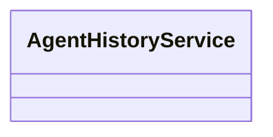

# src/logic/history/runtime 架构

## 设计意图

会话履历查询编排，依赖 logic/history/rules 履历契约，实际文件索引在 logic/history/service。

## 主要组成

| 组成 | 定位 |
| --- | --- |
| [AgentHistoryService](agent-history.ts) | 按工作区静态角色归档 Session 与运行摘要，向团队节点提供分页历史和受限事件详情。 |

<!-- architecture:generated:start -->

## 架构关系

[上层设计](../ARCHITECTURE.md)

<!-- architecture:generated:end -->
