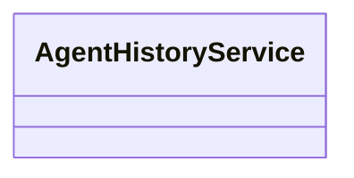

# src/logic/history/runtime 架构

## 设计意图

将已提交派发与执行日志投影为角色会话履历，隔离索引查询与真实运行。

`AgentHistoryService` 保存实例内索引及事件读取缓存，通过注入端口持久化和读取原日志。公开契约与存储接口来自 [team/rules](../../team/rules/ARCHITECTURE.md)，物理适配在 [service](../service/ARCHITECTURE.md)。初始化后接入观察，关闭前停止观察并等待索引写完；索引错误不能改写执行事实。

## 主要组成

| 组成 | 定位 |
| --- | --- |
| [AgentHistoryService](agent-history.ts) | 按工作区静态角色归档 Session 与运行摘要，向团队节点提供分页历史和受限事件详情。 |

<!-- architecture:generated:start -->

## 架构关系

[上层设计](../ARCHITECTURE.md)

<!-- architecture:generated:end -->
