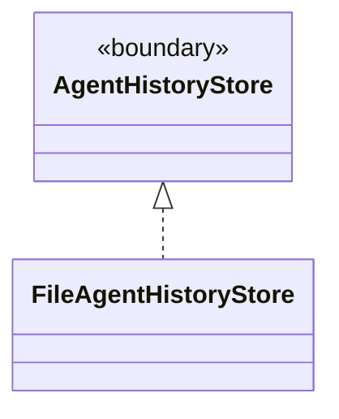

# src/logic/history/service 架构

## 设计意图

履历应用装配与文件索引。assembly.ts 连接角色/运行来源，file-store.ts 只实现 SessionHistoryStorage；文件存储不得反向依赖装配或工作区服务。

## 主要组成

| 组成 | 定位 |
| --- | --- |
| [FileAgentHistoryStore](file-store.ts) | 把静态 Agent 的 Session 派生索引保存到应用用户目录，只负责索引读写和目录校验。 |

<!-- architecture:generated:start -->

## 架构关系

外部继承／实现边界：[AgentHistoryStore](../../team/rules/session-history-storage.ts)。

[上层设计](../ARCHITECTURE.md)

<!-- architecture:generated:end -->
