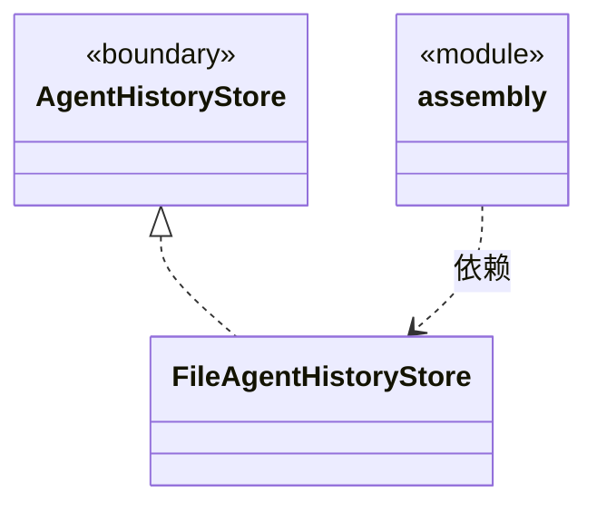

# src/logic/history/service 架构

## 设计意图

把角色历史查询接到本机派生索引与固定运行目录，隔离文件实现和可信应用装配。

`assembly` 在已持锁工作区内创建历史服务，向详情读取注入身份与路径复核；`FileAgentHistoryStore` 只读写索引。构造不自动恢复运行，初始化、撤销观察与关闭顺序由 Application 控制，文件存储不反向依赖装配。

## 主要组成

| 组成 | 定位 |
| --- | --- |
| [FileAgentHistoryStore](file-store.ts) | 把静态 Agent 的 Session 派生索引保存到应用用户目录，只负责索引读写和目录校验。 |
| [assembly](assembly.ts) | 在已持锁工作区组合历史查询、文件索引与受限日志读取。 |

<!-- architecture:generated:start -->

## 架构关系

外部继承／实现边界：[AgentHistoryStore](../../team/rules/session-history-storage.ts)。

[上层设计](../ARCHITECTURE.md)

<!-- architecture:generated:end -->
