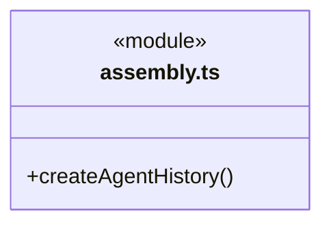
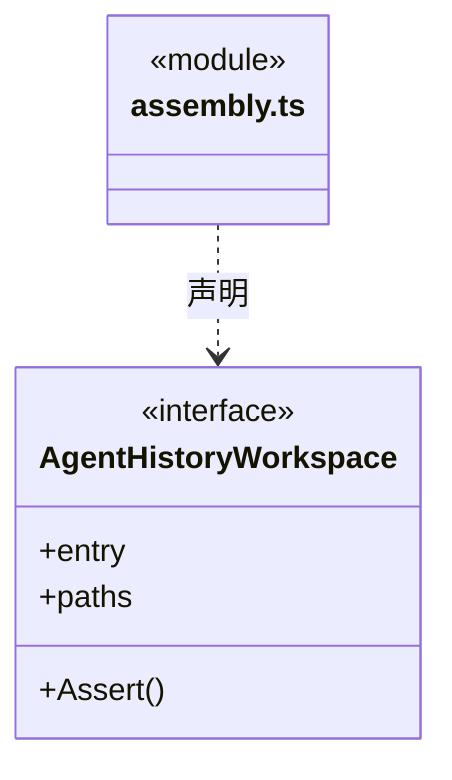
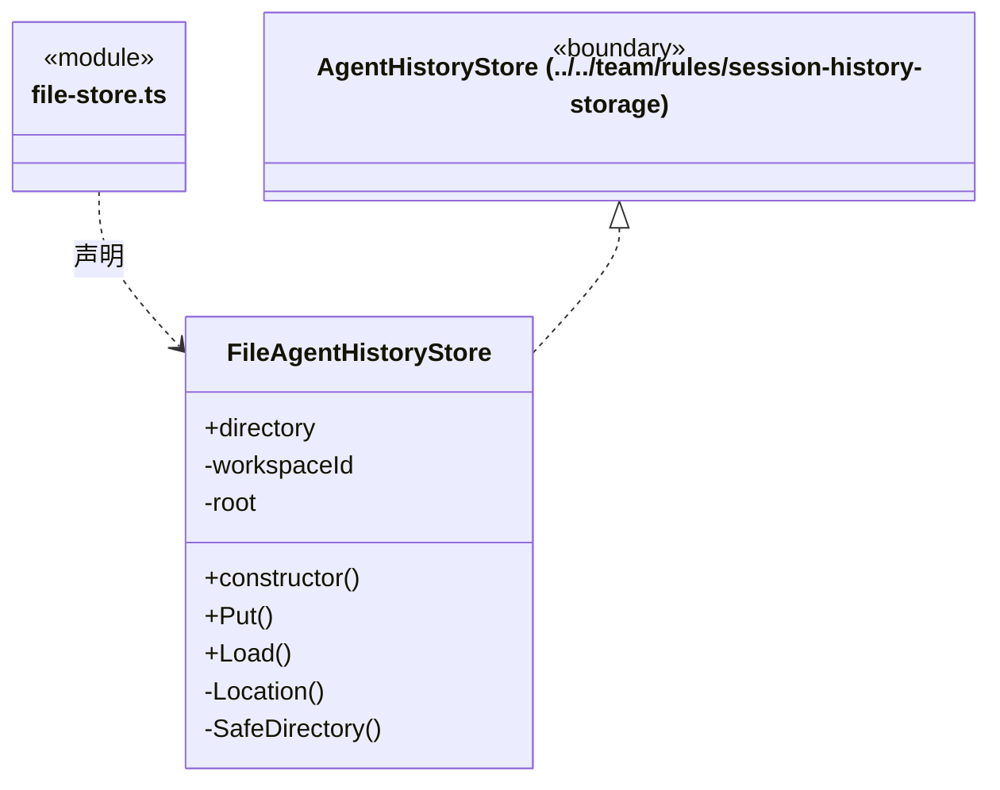
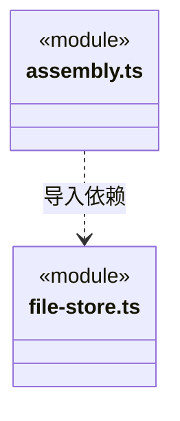

# src/logic/history/service 架构

本目录只维护这一份说明。设计与契约直接编辑本文；文件清单、类图和导航由 [架构脚本](../../../../scripts/source-architecture.mjs) 更新，生成区域之外的人工说明会保留。

## 封装意图

履历应用装配与文件索引。assembly.ts 连接角色/运行来源，file-store.ts 只实现 SessionHistoryStorage；文件存储不得反向依赖装配或工作区服务。

## 类与模块的设计意图

下表依据源码声明及文件头说明定位封装。字段表示该实例持有的状态或协作引用，不表示它拥有被引用服务的生命周期；实际资源责任和调用限制见下文契约及源码注释。

| 类／模块 | 实现形式与实例字段 | 封装依据 |
| --- | --- | --- |
| [assembly.ts](assembly.ts) | 函数／契约模块 | 生命周期和可信路径归应用装配所有，文件索引可独立复用；只接收身份、目录定位和可用性断言，不依赖完整 Workspace 类型。 |
| [FileAgentHistoryStore](file-store.ts) | 实例类；持有 `directory`、`workspaceId`、`root` | 文件只包含派生摘要；canonical 日志才是执行事实来源，损坏条目单独报告并等待回补。 |

## 接口设计契约

### history 持久化契约

##### 静态 Agent 会话归档索引

`FileAgentHistoryStore` 保存到应用用户目录 `paths.project(workspaceId)/agent-history/<角色摘要>/sessions/<会话摘要>/<运行摘要>.json`。名称摘要由可信静态角色、会话及 task/run 标识生成；外部请求不能提供目录或文件路径。每个轮次独立原子提交并同步文件，目录/条目符号链接及身份不匹配拒绝，损坏条目保留诊断且不影响其他记录读取。

归档文件只保存公开任务摘要、明确身份、生命周期状态和后端日志来源；不复制消息、工具正文、workflowContext 或原生会话文件。完整执行事实继续保存在原 `loop-engine/tasks` 和 `dispatch/runs/tasks`，不迁移、不合并、不写入可共享 `.cbim` 知识。执行实例释放、静态角色定义删除、正常工作区关闭都不删除归档。

装配入口位于 `../../agent-history.ts:createAgentHistory`，将固定运行根及 `FileRunStorage` 注入查询服务；本目录 `agent-history.ts` 只导出 `FileAgentHistoryStore`，不导入具体 Workspace 或调度服务。详情仅根据已核验索引的 source/task/run 定位，检查真实目录边界、符号链接及日志身份；首次读取后由已落盘观察维护增量。模型启动前已持久化但尚未创建 canonical 的派发意图也可归档，详情只呈现真实空前缀与失败状态。

启动时先核工作区路径、持有工程锁，再通过可信 `beforeDispatchLoad` 阶段加载历史索引；完成后唯一 Store 才首次读取，loaded 与来源恢复的 committed 都不会抢在历史装载之前。`WorkspaceRuntimeMonitor` 随后在原有两套日志扫描中幂等回补，并同时消费派发 loaded/committed 与主/成员事件；没有第二套定时全量扫描，也不为启动顺序放宽持久索引重复检测。列表只查轻量索引。异步索引错误进入服务及全局诊断，不阻断已提交的执行；关闭顺序为执行收尾、撤销观察、排空索引写入、释放工作区。

## 开闭边界

本目录的职责及允许协作由[封装意图](#封装意图)限定，输入输出、状态与失败语义以[接口设计契约](#接口设计契约)为准。扩展从已有公开入口及实际装配位置进入；没有明确可替换契约的部分按真实影响修改和验证，不预建未使用的基类或插件入口。

<!-- architecture:generated:start -->

## 文件清单

| 文件 | 形式 | 当前职责 |
| --- | --- | --- |
| [ARCHITECTURE.md](ARCHITECTURE.md) | 说明文档 | 本目录的文件清单、真实声明、依赖与子封装导航。 |
| [assembly.ts](assembly.ts) | 源码模块 | 在已持锁的工作区中组合角色历史服务、文件索引及 canonical 日志读取端口。 |
| [file-store.ts](file-store.ts) | 源码模块 | 把静态 Agent 的 Session 派生索引保存到应用用户目录，只负责索引读写和目录校验。 |

## 架构类图

成员标记：`+` 公开、`-` 私有、`#` 受保护、`$` 静态；`function` 为函数值成员，`get`／`set` 为访问器。调用／构造／索引签名按匿名签名列出，不虚构方法名；`global.` 表示全局声明补充，非运行时嵌套类。构造函数单独列出，运行时私有字段保留 `#`。文档和资源仅在文件清单中导航，不作为代码节点。

### assembly.ts

[查看源码](assembly.ts)。

直接依赖：[../../execution/ports/identity.ts](../../execution/ports/identity.ts)、[../../execution/storage/run-storage.ts](../../execution/storage/run-storage.ts)、[../runtime/agent-history.ts](../runtime/agent-history.ts)、[file-store.ts](file-store.ts)。

### file-store.ts

[查看源码](file-store.ts)。

继承／实现来源：`AgentHistoryStore` → [../../team/rules/session-history-storage.ts](../../team/rules/session-history-storage.ts)（声明 `AgentHistoryStore`）。
直接依赖：[../../../core/platform/node/files/index.ts](../../../core/platform/node/files/index.ts)、[../../../core/platform/node/serialization.ts](../../../core/platform/node/serialization.ts)、[../../team/rules/session-history-storage.ts](../../team/rules/session-history-storage.ts)。

### 本目录调用边界

## 子目录导航

无子目录。

[返回上层](../ARCHITECTURE.md)。

每次修改本目录代码，同步维护文件头、关键契约说明及本图。未实现的治理、证据验收和自动编排能力不列入当前类图。

<!-- architecture:generated:end -->
