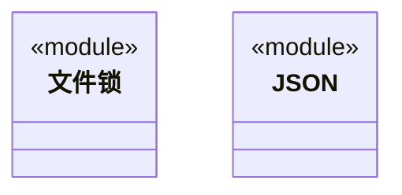

# IO 错误适配

## 设计意图

Logic 将严格 JSON 解析与原生文件锁的已知失败转换为原生 Error，保留具体原因。JSON 与锁分别导入，解析数据时无需加载原生库。

## 主要组成

| 入口 | 用途 |
| --- | --- |
| [JSON](json.ts) | 将语法错误与重复键转换为原生 Error。 |
| [文件锁](locking.ts) | 将锁占用和权限失败转换为原生 Error，保留原提示。 |

<!-- architecture:generated:start -->

## 架构关系

[上层设计](../ARCHITECTURE.md)

<!-- architecture:generated:end -->
