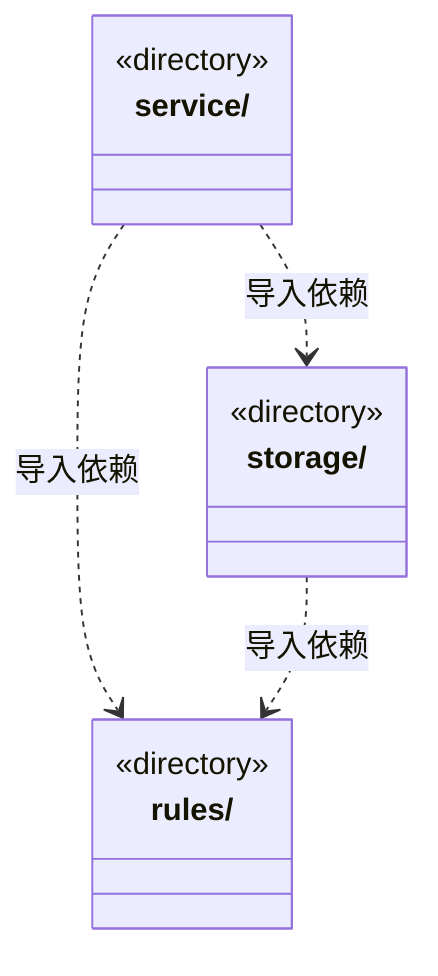

# src/logic/knowledge 架构

本目录只维护这一份说明。设计与契约直接编辑本文；文件清单、类图和导航由 [架构脚本](../../../scripts/source-architecture.mjs) 更新，生成区域之外的人工说明会保留。

## 封装意图

知识数据、只读视图、查询和写入端口；服务与规则分开归属，实际依赖通过明确入口验证。

## 类与模块的设计意图

本层没有直接源码声明，负责组合下级封装；各子系统的类、状态与公开入口见本文的[子目录导航](#子目录导航)。

## 接口设计契约

本层没有独立代码入口或运行实例。公开契约与资源生命周期分别归属下级封装，按[子目录导航](#子目录导航)进入实际所有者。

## 开闭边界

本目录的职责及允许协作由[封装意图](#封装意图)限定，输入输出、状态与失败语义以[接口设计契约](#接口设计契约)为准。扩展从已有公开入口及实际装配位置进入；没有明确可替换契约的部分按真实影响修改和验证，不预建未使用的基类或插件入口。

<!-- architecture:generated:start -->

## 文件清单

| 文件 | 形式 | 当前职责 |
| --- | --- | --- |
| [ARCHITECTURE.md](ARCHITECTURE.md) | 说明文档 | 本目录的文件清单、真实声明、依赖与子封装导航。 |

本层无直接代码文件。

## 架构类图

成员标记：`+` 公开、`-` 私有、`#` 受保护、`$` 静态；构造函数单独列出。文档和资源仅在文件清单中导航，不作为代码节点。

各图中的同名节点表示同一目录边界；跨组及完整直接依赖如下（无边不代表继承）：

- `service` → `rules`：导入。
- `service` → `storage`：导入。
- `storage` → `rules`：导入。

## 子目录导航

- [rules/](rules/ARCHITECTURE.md)：知识快照、校验、领域查询、对象变更和可移植静态包规划。私有v2计划冻结有序操作与整包替换范围，公共变更不能提供来源证明；物理事务与缓存经端口注入。团队能力可独立复用，业务模板必须完整，不携带动态成员或任务。 KnowledgeQueries 只接收 snapshot；KnowledgeRefresh 独立持有身份核实、原回执查询与提交。 read-models.ts 是固定快照读取的公开入口，snapshot 与 Team/BusinessWorkspace 模型属于同一私有实现边界；查询编排不反向进入纯快照契约。 产品反馈 Skill 只读发布两套上下文格式，不包含 GitHub 创建接口。 快照数据与只读访问是独立公共边界；索引刷新通过收窄端口调用原知识事务，不导入团队或模块查询视图。 SourceSnapshotReader 只提供知识队列外层的同版快照，调用方不得在任务事务内反向获取。 原知识工具和事务观察共用实际输入解析，纯摘要区分未查到、持久阶段及不可核实，不返回正文或私有路径。
- [service/](service/ARCHITECTURE.md)：知识来源登记与原命令回执核实；共用工作区派发存储，不另建恢复账本。
- [storage/](storage/ARCHITECTURE.md)：知识仓库文件、事务、缓存及对象写入实现。与 logic/knowledge/rules 的规则/存储端口单向连接，物理写入和授权语义不因目录迁移变化。

[返回上层](../ARCHITECTURE.md)。

每次修改本目录代码，同步维护文件头、关键契约说明及本图。未实现的治理、证据验收和自动编排能力不列入当前类图。

<!-- architecture:generated:end -->
