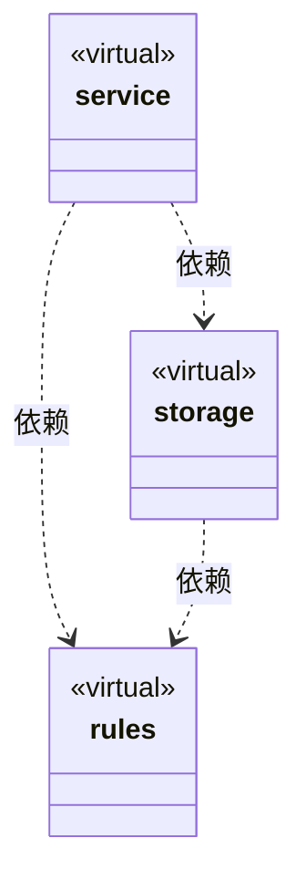

# src/logic/knowledge 架构

## 设计意图

管理正式知识的快照、校验、查询与受控修改，使权威正文和派生读取各有责任边界。

`rules` 解释知识及规划变更，`storage` 实施文件事务和恢复，`service` 把知识来源接到岗位与责任登记。查询不隐式刷新或提交，派生索引和缓存不是另一份正式知识；跨域来源需要与原事务记录核对。

## 主要组成

本层没有直接产品实现，由下方子模块组成；每个直接子模块作为一个虚拟封装，只在本层呈现整体职责与协作。

<!-- architecture:generated:start -->

## 架构关系

标注为 `virtual` 的节点是直接子模块的虚拟类封装；内部设计沿下方入口阅读。

## 子模块

| 虚拟封装 | 整体职责 |
| --- | --- |
| [rules](rules/ARCHITECTURE.md) | 围绕固定知识快照组织校验、查询和变更规划，通过明确端口隔离磁盘事务。 |
| [service](service/ARCHITECTURE.md) | 协调知识来源代次与岗位、模块责任的显式采纳，使变更依据与业务登记保持可追溯。 |
| [storage](storage/ARCHITECTURE.md) | 实现本机知识快照、预览计划与可恢复事务，集中维护物理文件的一致性。 |

[上层设计](../ARCHITECTURE.md)

<!-- architecture:generated:end -->
