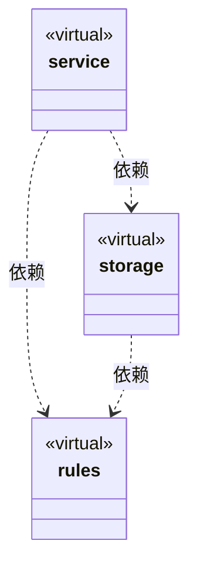

# src/logic/knowledge 架构

## 设计意图

封装正式知识的读取、校验、变更与存储。规则与只读模型表达领域含义，服务连接来源，存储实现事务与恢复；查询和修改走不同责任入口。

## 主要组成

本层由下列子模块组合，每个子模块作为独立的虚拟类封装参与本层协作。

<!-- architecture:generated:start -->

## 架构关系

标注为 `virtual` 的节点是直接子模块的虚拟类封装；内部设计沿下方入口阅读。

## 子模块

| 虚拟封装 | 整体职责 |
| --- | --- |
| [rules](rules/ARCHITECTURE.md) | 围绕知识快照组织校验、查询与对象变更。查询组合只读模型，刷新维护派生索引，变更规划通过存储端口提交；物理文件和事务实现留在外层。 |
| [service](service/ARCHITECTURE.md) | 知识来源登记与原命令回执核实；共用工作区派发存储，不另建恢复账本。 |
| [storage](storage/ARCHITECTURE.md) | 把知识规则接到本机文件，维护快照、预览缓存和可恢复事务。KnowledgeStore 组织物理提交，FileObjectStorage 提供对象规划所需的目录与缓存能力。 |

[上层设计](../ARCHITECTURE.md)

<!-- architecture:generated:end -->
