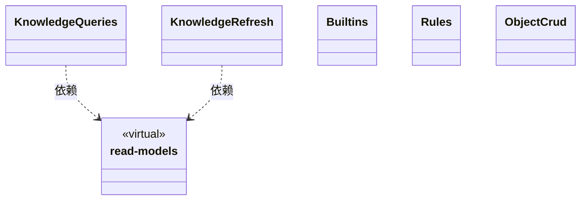
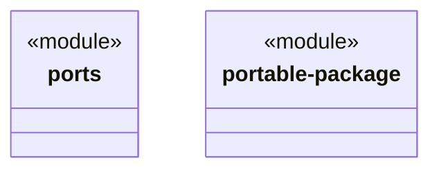

# src/logic/knowledge/rules 架构

## 设计意图

围绕知识快照组织校验、查询与对象变更。查询组合只读模型，刷新维护派生索引，变更规划通过存储端口提交；物理文件和事务实现留在外层。

## 主要组成

| 组成 | 定位 |
| --- | --- |
| [Builtins](builtins.ts) | Builtins：从 assets 白名单发布内置 Skill、规范和 Schema，包括团队/业务架构治理及只需简述、补充自愿的反馈流程。 |
| [KnowledgeQueries](knowledge-queries.ts) | 只读知识查询门面，取得快照并组合团队与业务模块读取模型。 |
| [KnowledgeRefresh](knowledge-refresh.ts) | 按原身份、版本与请求 ID 刷新派生知识索引，独立于只读领域查询。 |
| [Rules](knowledge.ts) | Logic 知识规则（Schema 来自显式 assetsRoot）：校验领域结构、专业正文和引用，并派生注册索引。 |
| [ObjectCrud](object-crud.ts) | 规划 Agent、Module、Skill 与 Workflow 的知识变更，通过存储端口提交受控事务。 |
| [portable-package](portable-package.ts) | 把工作区静态团队能力或完整业务架构转为可复用资源包，并纯计算目标知识变更。 |
| [ports](ports.ts) | 核心知识领域需要的工作区存取与事务接口。 |

<!-- architecture:generated:start -->

## 架构关系

标注为 `virtual` 的节点是直接子模块的虚拟类封装；内部设计沿下方入口阅读。

### 关系组 1

### 关系组 2

### 跨图协作

- [ObjectCrud](object-crud.ts)（图 1）→ [ports](ports.ts)（图 2）：依赖。

## 子模块

| 虚拟封装 | 整体职责 |
| --- | --- |
| [read-models](read-models/ARCHITECTURE.md) | 把已校验的固定知识快照投影为团队与业务工作区视图。Team 和 BusinessWorkspace 分别封装各自领域读取，公共入口统一提供查询，不加载写入编排或文件存储。 |

[上层设计](../ARCHITECTURE.md)

<!-- architecture:generated:end -->
