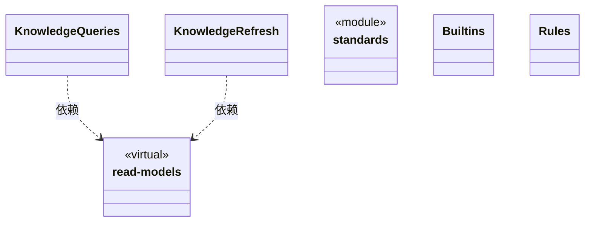
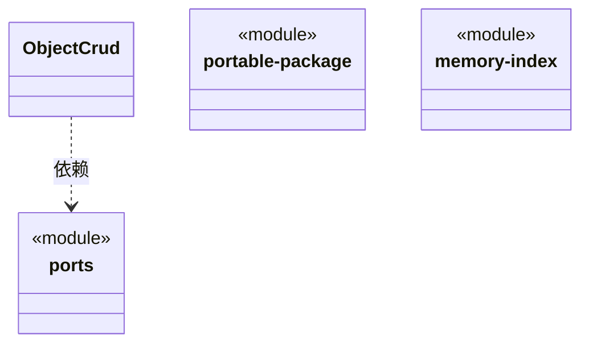

# src/logic/knowledge/rules 架构

## 设计意图

围绕固定知识快照组织校验、查询和变更规划，通过明确端口隔离磁盘事务。

`Builtins` 组合所属业务的代码常量，`Rules` 校验正文与结构；`KnowledgeQueries` 组合只读模型，`KnowledgeRefresh` 单独刷新索引，`ObjectCrud` 规划并提交受控变更。`read-models` 仅解释已校验快照；正式写入仍需版本、来源和事务检查。

## 主要组成

| 组成 | 定位 |
| --- | --- |
| [standards](standards.ts) | 知识查询、治理和共享 Skill／Workflow 的通用正文；只提供规则，不持有工作区状态。 |
| [Builtins](builtins.ts) | 无状态只读目录，组合各业务模块的规范常量，发布 Skill、Schema、正文版本和引用；不读取安装目录。 |
| [KnowledgeQueries](knowledge-queries.ts) | 只读知识查询门面，取得快照并组合团队与业务模块读取模型。 |
| [KnowledgeRefresh](knowledge-refresh.ts) | 按原身份、版本与请求 ID 刷新派生知识索引，独立于只读领域查询。 |
| [Rules](knowledge.ts) | Logic 知识规则（Schema 来自所属业务模块常量）：校验领域结构、专业正文和引用，并派生注册索引。 |
| [ObjectCrud](object-crud.ts) | 规划 Agent、Module、Skill 与 Workflow 的知识变更，通过存储端口提交受控事务。 |
| [portable-package](portable-package.ts) | 把工作区静态团队能力或完整业务架构转为可复用资源包，并纯计算目标知识变更。 |
| [ports](ports.ts) | 核心知识领域需要的工作区存取与事务接口。 |
| [memory-index](memory-index.ts) | 按知识版本、向量模型和分块策略构建可重建的派生检索索引。 |

## 现状与目标边界

当前校验、查询、刷新及对象规划直接位于父层，只读模型已在 `read-models` 封装。目标是按查询、校验和变更规划的不同能力需求继续收敛实现边界；这些新封装尚未存在，当前图仍展示实际类与引用。特别要保留 KnowledgeQueries 只需快照、KnowledgeRefresh 需要提交端口、ObjectCrud 需要预览与事务的差异，不能因都使用知识而统一成宽接口。

<!-- architecture:generated:start -->

## 架构关系

标注为 `virtual` 的节点是直接子模块的虚拟类封装；内部设计沿下方入口阅读。

### 关系组 1：read-models

### 关系组 2：ObjectCrud

## 子模块

| 虚拟封装 | 整体职责 |
| --- | --- |
| [read-models](read-models/ARCHITECTURE.md) | 把已校验的固定知识快照转换为团队与业务工作区读取模型，避免查询获得修改能力。 |

[上层设计](../ARCHITECTURE.md)

<!-- architecture:generated:end -->
