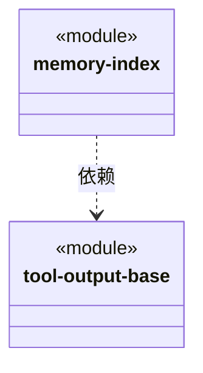

# src/logic/knowledge/rules 架构

## 设计意图

保存引擎记忆和工具输出使用的纯数据协议。旧知识存储、事务和索引服务已移除；本目录不加载工作区文件。

## 主要组成

| 组成 | 定位 |
| --- | --- |
| [memory-index](memory-index.ts) | 正式知识的派生向量索引规则，固定来源版本、向量模型和分块策略，提供可重建的代际与检索。 |
| [tool-output-base](tool-output-base.ts) | 知识工具的身份、文件、校验与快照输出协议，供注册边界及具体查询协议复用。 |

<!-- architecture:generated:start -->

## 架构关系

[上层设计](../ARCHITECTURE.md)

<!-- architecture:generated:end -->
