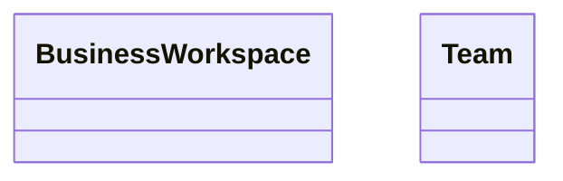

# src/logic/knowledge/rules/read-models 架构

## 设计意图

把已校验的固定知识快照投影为团队与业务工作区视图。Team 和 BusinessWorkspace 分别封装各自领域读取，公共入口统一提供查询，不加载写入编排或文件存储。

## 主要组成

| 组成 | 定位 |
| --- | --- |
| [Team](team.ts) | 团队：Team/小组/Agent 与 Agent 自身和祖先 Skill的核心封装。 |
| [BusinessWorkspace](workspace.ts) | 业务工作区：领域工程与模块注册表、模块知识和仅本模块 Workflow的核心封装。 |

<!-- architecture:generated:start -->

## 架构关系

[上层设计](../ARCHITECTURE.md)

<!-- architecture:generated:end -->
