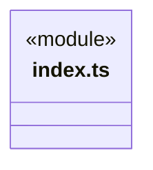
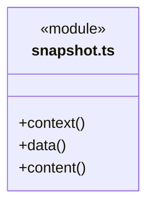
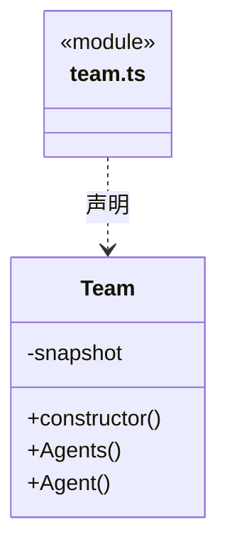
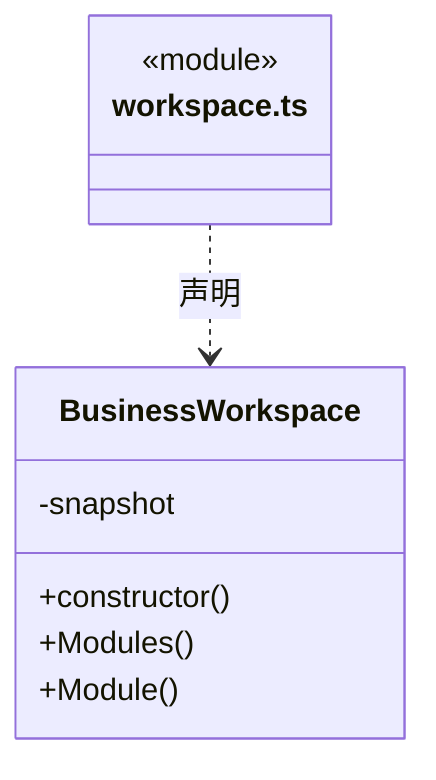
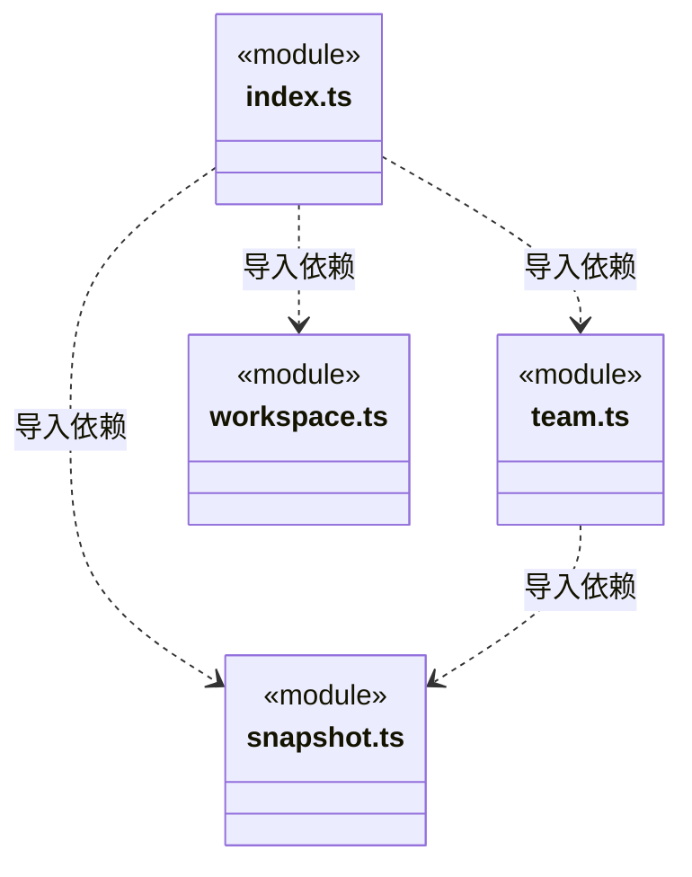
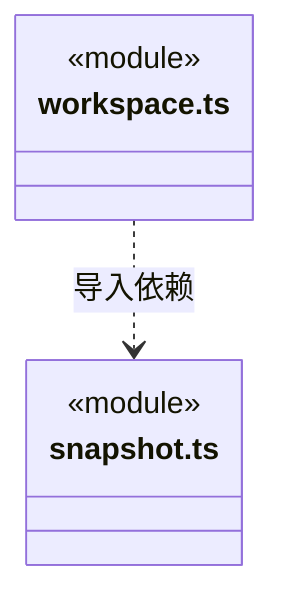

# src/logic/knowledge/rules/read-models 架构

本目录只维护这一份说明。设计与契约直接编辑本文；文件清单、类图和导航由 [架构脚本](../../../../../scripts/source-architecture.mjs) 更新，生成区域之外的人工说明会保留。

## 封装意图

知识只读模型边界：snapshot、team、workspace 是私有实现，只通过 index.ts 提供公开查询。类型、领域工程定义与纯基础构成允许依赖；不加载查询编排、文件存储或 SDK。

## 类与模块的设计意图

下表依据源码声明及文件头说明定位封装。字段表示该实例持有的状态或协作引用，不表示它拥有被引用服务的生命周期；实际资源责任和调用限制见下文契约及源码注释。

| 类／模块 | 实现形式与实例字段 | 封装依据 |
| --- | --- | --- |
| [index.ts](index.ts) | 函数／契约模块 | 将公开契约与分散在 team/workspace 的读取实现分开；消费者不再直达私有模型，读取链只能依赖快照数据和纯基础能力。 |
| [snapshot.ts](snapshot.ts) | 函数／契约模块 | 团队与业务领域共用只读快照辅助；严格 JSON 解析来自 Foundation，不经知识查询门面反向调用领域模型。 |
| [Team](team.ts) | 实例类；持有 `snapshot` | 实例固定绑定一个快照；刷新知识后由调用方创建新的领域视图。 |
| [BusinessWorkspace](workspace.ts) | 实例类；持有 `snapshot` | 实例固定绑定一个快照；刷新知识后由调用方创建新的领域视图。 |

## 接口设计契约

- [index.ts](index.ts)：职责边界：不读取磁盘、不刷新或提交知识、不管理实例生命周期；传入快照的校验、版本及权限由调用方负责。
- [snapshot.ts](snapshot.ts)：读取边界：本文件属于读取模型内部实现；跨边界正文查询统一从 read-models 导入，不能据此读取或提交磁盘知识。
- [team.ts](team.ts)：读取边界：本类属于 knowledge-read-models 的私有实现，跨模块经 knowledge/read-models 入口访问；团队岗位和执行状态不归此视图维护。
- [workspace.ts](workspace.ts)：读取边界：本类属于 knowledge-read-models 的私有实现，跨模块经 knowledge/read-models 入口访问；模块责任与知识提交仍归各自服务。

## 开闭边界

本目录的职责及允许协作由[封装意图](#封装意图)限定，输入输出、状态与失败语义以[接口设计契约](#接口设计契约)为准。扩展从已有公开入口及实际装配位置进入；没有明确可替换契约的部分按真实影响修改和验证，不预建未使用的基类或插件入口。

<!-- architecture:generated:start -->

## 文件清单

| 文件 | 形式 | 当前职责 |
| --- | --- | --- |
| [ARCHITECTURE.md](ARCHITECTURE.md) | 说明文档 | 本目录的文件清单、真实声明、依赖与子封装导航。 |
| [index.ts](index.ts) | 源码模块 | 固定知识快照的公开读取入口，向查询编排、成员上下文和测试提供 Team、BusinessWorkspace 及正文读取。 |
| [snapshot.ts](snapshot.ts) | 源码模块 | 已校验知识快照的版本信息、定义读取和受限正文引用解析。 |
| [team.ts](team.ts) | 源码模块 | 团队：Team/小组/Agent 与 Agent 自身和祖先 Skill的核心封装。 |
| [workspace.ts](workspace.ts) | 源码模块 | 业务工作区：领域工程与模块注册表、模块知识和仅本模块 Workflow的核心封装。 |

## 架构类图

成员标记：`+` 公开、`-` 私有、`#` 受保护、`$` 静态；构造函数单独列出。文档和资源仅在文件清单中导航，不作为代码节点。

### index.ts

直接依赖：[snapshot.ts](snapshot.ts)、[team.ts](team.ts)、[workspace.ts](workspace.ts)。

### snapshot.ts

直接依赖：[../../../../core/errors.ts](../../../../core/errors.ts)、[../../../../core/json.ts](../../../../core/json.ts)、[../types.ts](../types.ts)。

### team.ts

直接依赖：[../../../../core/errors.ts](../../../../core/errors.ts)、[../../../../core/json.ts](../../../../core/json.ts)、[snapshot.ts](snapshot.ts)、[../types.ts](../types.ts)。

### workspace.ts

直接依赖：[../../../../core/errors.ts](../../../../core/errors.ts)、[../../../../core/json.ts](../../../../core/json.ts)、[snapshot.ts](snapshot.ts)、[../types.ts](../types.ts)、[../../../workspace/rules/project-root.ts](../../../workspace/rules/project-root.ts)。

### 本目录调用边界

## 子目录导航

无子目录。

[返回上层](../ARCHITECTURE.md)。

每次修改本目录代码，同步维护文件头、关键契约说明及本图。未实现的治理、证据验收和自动编排能力不列入当前类图。

<!-- architecture:generated:end -->
