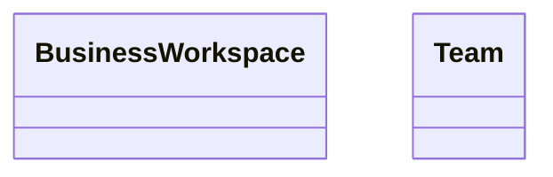

# src/logic/knowledge/rules/read-models 架构

## 设计意图

把已校验的固定知识快照转换为团队与业务工作区读取模型，避免查询获得修改能力。

`Team` 解释团队、小组、Agent 与 Skill 归属，`BusinessWorkspace` 解释工程、模块及本模块 Workflow；`snapshot` 提供受限正文引用解析。实例消费给定快照，不追踪磁盘变化，刷新和写事务由外部服务负责。

## 主要组成

| 组成 | 定位 |
| --- | --- |
| [Team](team.ts) | 从固定快照读取团队、小组、Agent 与自身及祖先 Skill，不持有写权限。 |
| [BusinessWorkspace](workspace.ts) | 从固定快照读取领域工程、模块及本模块 Workflow，不向祖先或子模块隐式扩展范围。 |

<!-- architecture:generated:start -->

## 架构关系

[上层设计](../ARCHITECTURE.md)

<!-- architecture:generated:end -->
