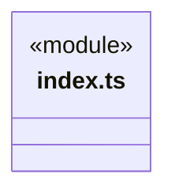
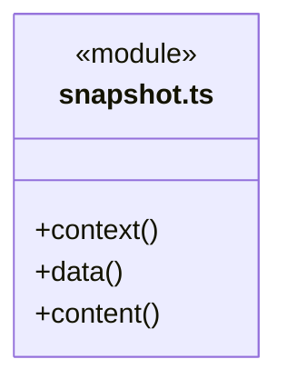
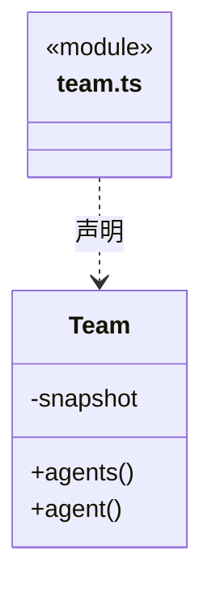
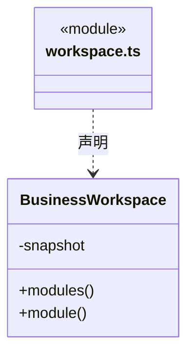
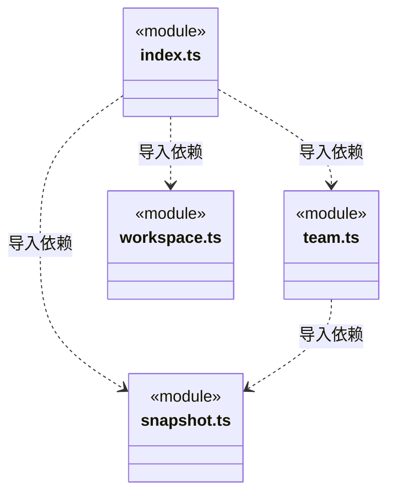
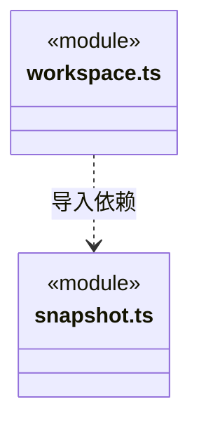

# src/logic/knowledge/rules/read-models 架构

## 目录定位

知识只读模型边界：snapshot、team、workspace 是私有实现，只通过 index.ts 提供公开查询。类型、领域工程定义与纯基础构成允许依赖；不加载查询编排、文件存储或 SDK。

本文描述当前实现。通过分析目录边界后维护的 [源码架构脚本](../../../../../scripts/source-architecture.mjs) 同步清单和声明；代码变更时仍须核对职责、关键成员与关系。

## 代码清单

| 文件 | 当前职责 |
| --- | --- |
| [index.ts](index.ts) | 固定知识快照的公开读取入口，向查询编排、成员上下文和测试提供 Team、BusinessWorkspace 及正文读取。 |
| [snapshot.ts](snapshot.ts) | 已校验知识快照的版本信息、定义读取和受限正文引用解析。 |
| [team.ts](team.ts) | 团队：Team/小组/Agent 与 Agent 自身和祖先 Skill的核心封装。 |
| [workspace.ts](workspace.ts) | 业务工作区：领域工程与模块注册表、模块知识和仅本模块 Workflow的核心封装。 |

## 架构类图

### index.ts

直接依赖：[team.ts](team.ts)、[workspace.ts](workspace.ts)、[snapshot.ts](snapshot.ts)。

### snapshot.ts

直接依赖：[../../../../core/errors.ts](../../../../core/errors.ts)、[../../../../core/json.ts](../../../../core/json.ts)、[../types.ts](../types.ts)。

### team.ts

直接依赖：[snapshot.ts](snapshot.ts)、[../../../../core/json.ts](../../../../core/json.ts)、[../../../../core/errors.ts](../../../../core/errors.ts)、[../types.ts](../types.ts)。

### workspace.ts

直接依赖：[snapshot.ts](snapshot.ts)、[../../../../core/json.ts](../../../../core/json.ts)、[../../../../core/errors.ts](../../../../core/errors.ts)、[../types.ts](../types.ts)、[../../../workspace/rules/project-root.ts](../../../workspace/rules/project-root.ts)。

### 本目录调用边界

## 子目录导航

无子目录。

[返回上层](../ARCHITECTURE.md)。

每次修改本目录代码，同步维护文件头、关键契约说明及本图。未实现的治理、证据验收和自动编排能力不列入当前类图。
