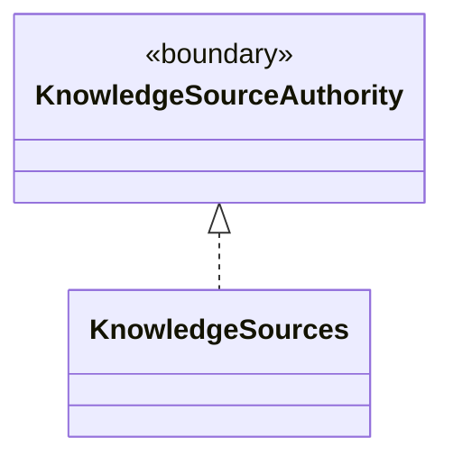

# src/logic/knowledge/service 架构

## 设计意图

知识来源登记与原命令回执核实；共用工作区派发存储，不另建恢复账本。

## 主要组成

| 组成 | 定位 |
| --- | --- |
| [KnowledgeSources](knowledge-sources.ts) | 将原知识事务的来源屏障与岗位/责任的明确来源采纳接到唯一 DispatchStore。 |

<!-- architecture:generated:start -->

## 架构关系

外部继承／实现边界：[KnowledgeSourceAuthority](../storage/source-journal.ts)。

[上层设计](../ARCHITECTURE.md)

<!-- architecture:generated:end -->
