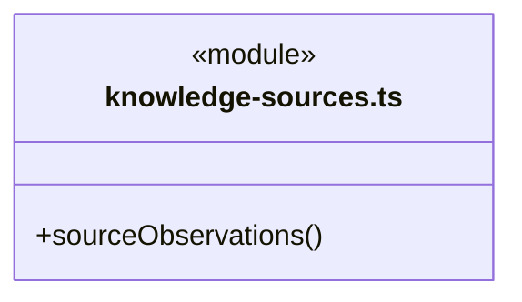
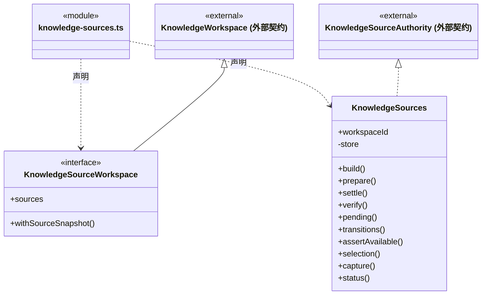

# src/logic/knowledge/service 架构

## 目录定位

知识来源登记与原命令回执核实；共用工作区派发存储，不另建恢复账本。

本文描述当前实现。通过分析目录边界后维护的 [源码架构脚本](../../../../scripts/source-architecture.mjs) 同步清单和声明；代码变更时仍须核对职责、关键成员与关系。

## 代码清单

| 文件 | 当前职责 |
| --- | --- |
| [knowledge-sources.ts](knowledge-sources.ts) | 将原知识事务的来源屏障与岗位/责任的明确来源采纳接到唯一 DispatchStore。 |

## 架构类图

### knowledge-sources.ts

直接依赖：[../../../core/platform/node/serialization.ts](../../../core/platform/node/serialization.ts)、[../../../core/json.ts](../../../core/json.ts)、[../../../core/errors.ts](../../../core/errors.ts)、[../../dispatch/rules/dispatch-storage.ts](../../dispatch/rules/dispatch-storage.ts)、[../rules/types.ts](../rules/types.ts)、[../rules/ports.ts](../rules/ports.ts)、[../rules/planned-commit.ts](../rules/planned-commit.ts)、[../../workspace/rules/knowledge-source.ts](../../workspace/rules/knowledge-source.ts)、[../../workspace/rules/knowledge-source-rules.ts](../../workspace/rules/knowledge-source-rules.ts)、[../storage/source-journal.ts](../storage/source-journal.ts)。

## 子目录导航

无子目录。

[返回上层](../ARCHITECTURE.md)。

每次修改本目录代码，同步维护文件头、关键契约说明及本图。未实现的治理、证据验收和自动编排能力不列入当前类图。
