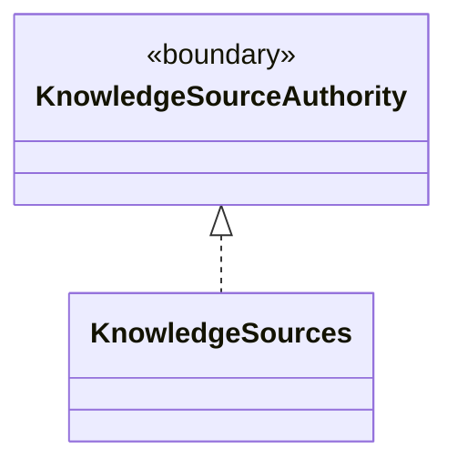

# src/logic/knowledge/service 架构

## 设计意图

协调知识来源代次与岗位、模块责任的显式采纳，使变更依据与业务登记保持可追溯。

`KnowledgeSources` 在原知识事务与唯一 DispatchStore 之间维护来源屏障和原命令核实。它不复制知识正文或另建恢复账本，来源已更新与岗位已采纳分别记录，调用方不能根据最新文件猜测旧登记依据。

## 主要组成

| 组成 | 定位 |
| --- | --- |
| [KnowledgeSources](knowledge-sources.ts) | 将原知识事务的来源屏障与岗位/责任的明确来源采纳接到唯一 DispatchStore。 |

<!-- architecture:generated:start -->

## 架构关系

外部继承／实现边界：[KnowledgeSourceAuthority](../storage/source-journal.ts)。

[上层设计](../ARCHITECTURE.md)

<!-- architecture:generated:end -->
