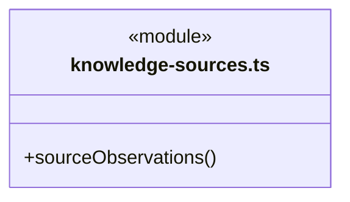
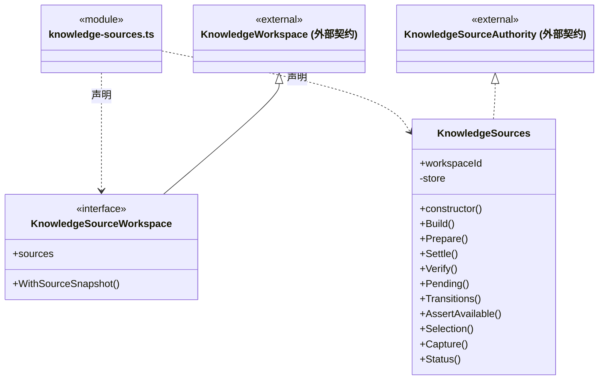

# src/logic/knowledge/service 架构

本目录只维护这一份说明。设计与契约直接编辑本文；文件清单、类图和导航由 [架构脚本](../../../../scripts/source-architecture.mjs) 更新，生成区域之外的人工说明会保留。

## 封装意图

知识来源登记与原命令回执核实；共用工作区派发存储，不另建恢复账本。

## 类与模块的设计意图

下表依据源码声明及文件头说明定位封装。字段表示该实例持有的状态或协作引用，不表示它拥有被引用服务的生命周期；实际资源责任和调用限制见下文契约及源码注释。

| 类／模块 | 实现形式与实例字段 | 封装依据 |
| --- | --- | --- |
| [KnowledgeSources](knowledge-sources.ts) | 实例类；持有 `workspaceId`、`store` | 所有来源 heads 都从共享日志读取；本协调器不拥有第二份可变登记文件。 |

## 接口设计契约

- [knowledge-sources.ts](knowledge-sources.ts)：锁序：调用方持知识 serial 时只等待本 Store 事务；本文件的事务回调不得反向排队知识方法。

## 开闭边界

本目录的职责及允许协作由[封装意图](#封装意图)限定，输入输出、状态与失败语义以[接口设计契约](#接口设计契约)为准。扩展从已有公开入口及实际装配位置进入；没有明确可替换契约的部分按真实影响修改和验证，不预建未使用的基类或插件入口。

<!-- architecture:generated:start -->

## 文件清单

| 文件 | 形式 | 当前职责 |
| --- | --- | --- |
| [ARCHITECTURE.md](ARCHITECTURE.md) | 说明文档 | 本目录的文件清单、真实声明、依赖与子封装导航。 |
| [knowledge-sources.ts](knowledge-sources.ts) | 源码模块 | 将原知识事务的来源屏障与岗位/责任的明确来源采纳接到唯一 DispatchStore。 |

## 架构类图

成员标记：`+` 公开、`-` 私有、`#` 受保护、`$` 静态；构造函数单独列出。文档和资源仅在文件清单中导航，不作为代码节点。

### knowledge-sources.ts

直接依赖：[../../../core/platform/node/serialization.ts](../../../core/platform/node/serialization.ts)、[../../../core/json.ts](../../../core/json.ts)、[../../../core/errors.ts](../../../core/errors.ts)、[../../dispatch/rules/dispatch-storage.ts](../../dispatch/rules/dispatch-storage.ts)、[../rules/types.ts](../rules/types.ts)、[../rules/ports.ts](../rules/ports.ts)、[../rules/planned-commit.ts](../rules/planned-commit.ts)、[../../workspace/rules/knowledge-source.ts](../../workspace/rules/knowledge-source.ts)、[../../workspace/rules/knowledge-source-rules.ts](../../workspace/rules/knowledge-source-rules.ts)、[../storage/source-journal.ts](../storage/source-journal.ts)。

## 子目录导航

无子目录。

[返回上层](../ARCHITECTURE.md)。

每次修改本目录代码，同步维护文件头、关键契约说明及本图。未实现的治理、证据验收和自动编排能力不列入当前类图。

<!-- architecture:generated:end -->
