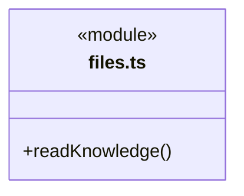
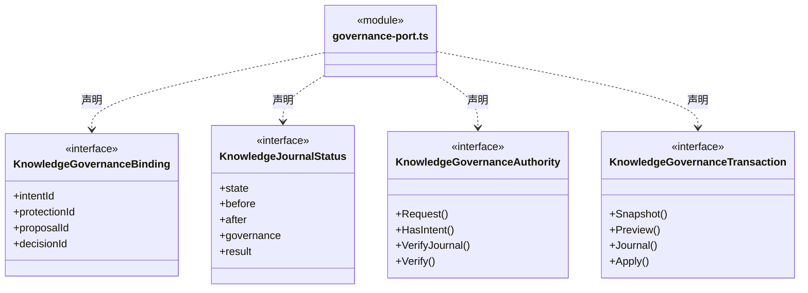
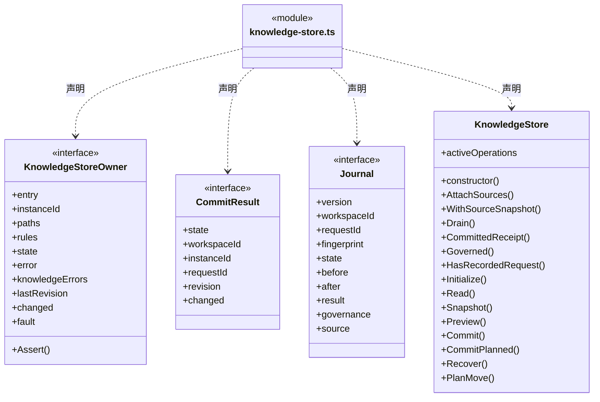
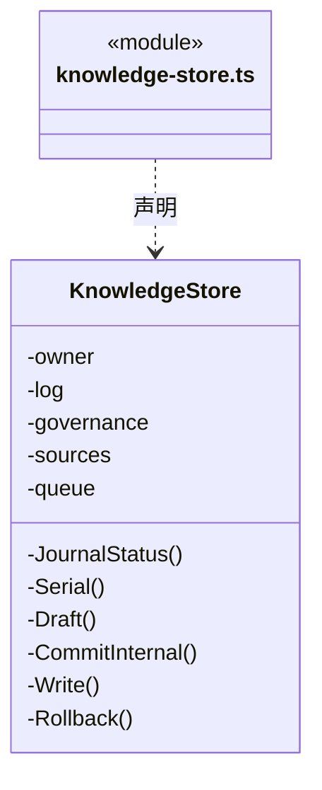
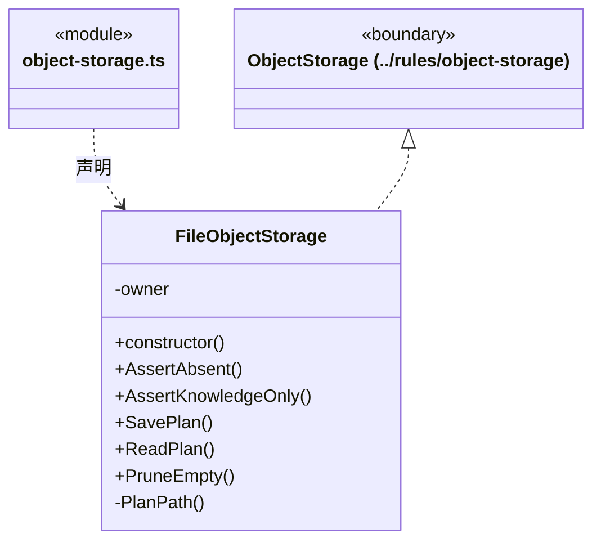
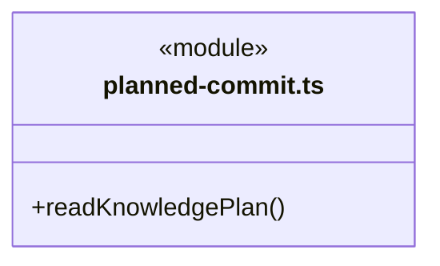
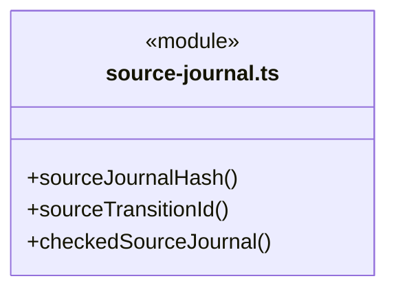
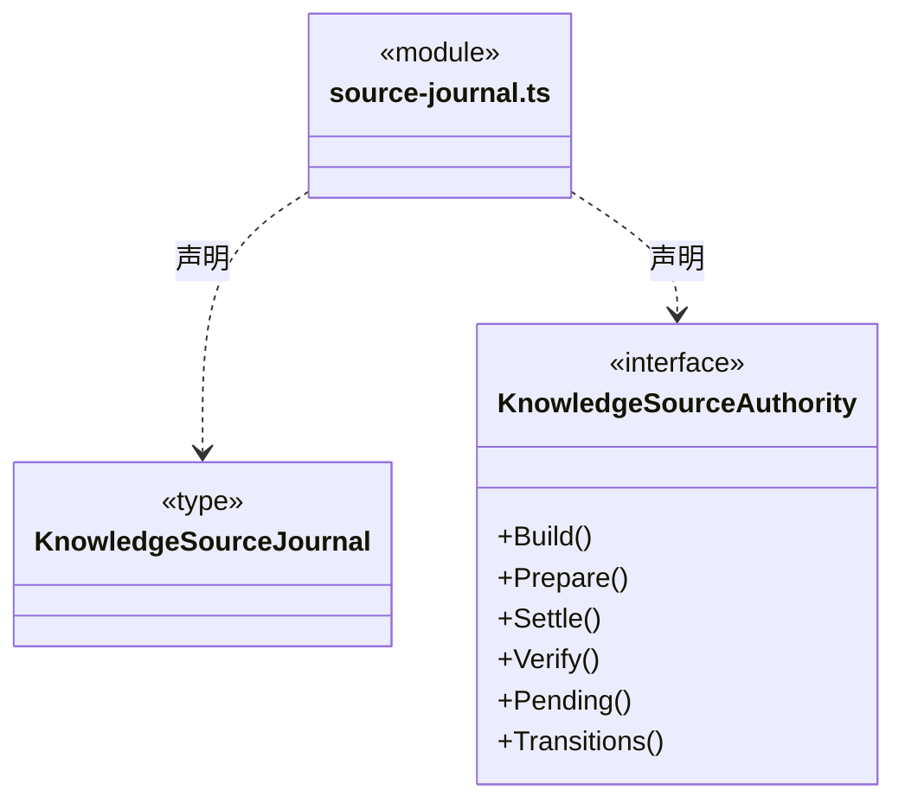
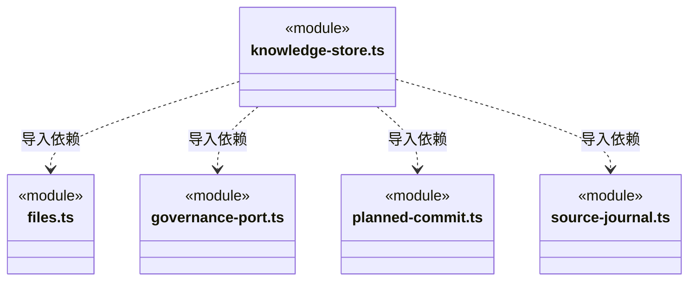

# src/logic/knowledge/storage 架构

本目录只维护这一份说明。设计与契约直接编辑本文；文件清单、类图和导航由 [架构脚本](../../../../scripts/source-architecture.mjs) 更新，生成区域之外的人工说明会保留。

## 封装意图

知识仓库文件、事务、缓存及对象写入实现。与 logic/knowledge/rules 的规则/存储端口单向连接，物理写入和授权语义不因目录迁移变化。

## 类与模块的设计意图

下表依据源码声明及文件头说明定位封装。字段表示该实例持有的状态或协作引用，不表示它拥有被引用服务的生命周期；实际资源责任和调用限制见下文契约及源码注释。

| 类／模块 | 实现形式与实例字段 | 封装依据 |
| --- | --- | --- |
| [files.ts](files.ts) | 函数／契约模块 | 物理遍历、大小限制和链接检查与领域校验分开；只读取 .cbim 的允许内容，保留原始哈希语义。 |
| [governance-port.ts](governance-port.ts) | 函数／契约模块 | 保护规则、人工决定和知识写入必须共用同一串行边界，但账本不能反向调用工作区形成锁循环。 |
| [KnowledgeStore](knowledge-store.ts) | 实例类；持有 `queue`、`activeOperations`、`owner`、`log`、`governance`、`sources` | 工作区持有一个存储实例，关闭前等待 drain，观察器避开正在提交的事务。 |
| [FileObjectStorage](object-storage.ts) | 实例类；持有 `owner` | owner 只提供工程身份和路径端口，不依赖 Workspace 生命周期实现。 |
| [planned-commit.ts](planned-commit.ts) | 函数／契约模块 | 模型只可引用 planId；完整替换范围不能由公共 ChangeRequest 或可变回执缓存注入。旧计划仅可用于查询原成功 journal。 |
| [source-journal.ts](source-journal.ts) | 函数／契约模块 | Dispatch 只保存紧凑屏障，恢复所需的原请求及计划留在原知识日志；证明必须覆盖正文、派生索引和可信替换语义，不能根据当前文件猜成功。 |

## 接口设计契约

### 正式知识物理事务

`KnowledgeStore` 是正式知识写入的唯一串行队列。所有普通提交继续核实例、读取版本、完整结构、逐文件外部冲突及原请求幂等；治理登记和决定通过 `Governed` 共享此队列，避免批准检查与提交之间出现其他决定或写入。

`governance-port.ts` 只声明 Main 内部端口，不进入 ChangeRequest 或模型工具输入。普通 `commit(request)` 永远不接 permit。可信 `apply(intentId)` 由私有治理账本解析精确请求，最终投影门禁在 prepared journal 之前执行；任何准备失败都不取得额外权限。

Journal 的可选 governance 绑定保留 intent/protection/proposal/decision ID；旧无治理日志保持兼容。只读原回执同时核完整请求指纹、before/after 键和值、请求差异、派生索引范围及 committed.changed。治理日志再核私有提案的精确前后正文；仅形状合法的 result 不代表真实知识已提交。

新提交在进入队列和开始时仍要求 running。已经开始事务、正在验证投影或治理门禁时，close/restart 只进入 closing 并等待 drain；门禁返回后继续核原身份和知识版本，不把 closing 当成取消已受理提交。治理实施在进入实际知识事务之后遵循同一规则；尚未开始的旧意图不会因此自动执行。

重开对原未完成事务执行既有安全回滚，不重放实施意图。治理记录按文件 ID 和私有 intent 双向识别，在回滚前验证来源；删除 journal 内的 governance 字段不能绕过核验。已提交之后的展示或响应失败不会撤销知识结果，后续查询只读取原日志。关闭等待队列排空再释放工作区锁。

#### 来源代次握手与原日志恢复

固定 `planned-commit.ts` 加载器只读取本工作区 object-plans/resource-imports 的原计划；`source-journal.ts` 绑定完整原请求、不可变计划、before/after 哈希及同一 DispatchStore 的过渡。知识串行队列先校验与预留来源容量，再写 prepared journal、可靠保存 Store pending，之后才允许 committing 与知识文件写入。知识队列可等待 Store，Store 回调不重新排队知识操作。

原 committed 落盘后，来源 final 与 committed 通知在文件回滚 catch 之外。结算失败保留真实知识成果；重开只按同一 journal 补原 resolved，不再执行请求。原日志缺失、被删除来源标记、身份/指纹/正文不符或 committing/committed 缺原 pending 都拒绝恢复。

prepared 保存或 Store prepare 异常时，只有严格核实原 Store 屏障才能继续提供只读诊断；否则实例进入 recovery_required，防止后来事务覆盖未核实的 before。重开遇 prepared 且无 Store 受理，只能在全部文件仍等 before 时标 rolled_back，绝不把外部恰等 after 的内容写回；冲突零文件写并保留证据。旧无来源 journal 保留原恢复协议，不自动升级或补造来源。

`WithSourceSnapshot` 为明确岗位/责任采纳固定知识快照，再进入唯一 Store；关闭先 drain 该队列与来源结算，再关闭 Store 和释放工作区锁。

##### 历史人员文件兼容

初始化只生成六份基础知识文件，不生成 team/people.json；现存文件不迁移、不删除，读取仍保留原字节，Rules 不再解析或校验其人员和组引用。知识版本仍由实际文件快照决定，废弃业务语义不等于绕过事务版本检查。

## 开闭边界

本目录的职责及允许协作由[封装意图](#封装意图)限定，输入输出、状态与失败语义以[接口设计契约](#接口设计契约)为准。扩展从已有公开入口及实际装配位置进入；没有明确可替换契约的部分按真实影响修改和验证，不预建未使用的基类或插件入口。

<!-- architecture:generated:start -->

## 文件清单

| 文件 | 形式 | 当前职责 |
| --- | --- | --- |
| [ARCHITECTURE.md](ARCHITECTURE.md) | 说明文档 | 本目录的文件清单、真实声明、依赖与子封装导航。 |
| [files.ts](files.ts) | 源码模块 | 从本机项目读取受控的正式知识文件。 |
| [governance-port.ts](governance-port.ts) | 源码模块 | 知识物理事务与私有治理账本之间的窄端口；仅供 Main 的可信工作区装配。 |
| [knowledge-store.ts](knowledge-store.ts) | 源码模块 | 本机知识存储，承担初始化、快照、预览、串行事务、索引写入和崩溃恢复。 |
| [object-storage.ts](object-storage.ts) | 源码模块 | 对象预览缓存、目录存在性检查和提交后空目录清理的本机实现。 |
| [planned-commit.ts](planned-commit.ts) | 源码模块 | 从固定私有缓存读取对象及资源包计划，向知识事务提供原请求与经过核实的不可变语义。 |
| [source-journal.ts](source-journal.ts) | 源码模块 | 知识 journal 的来源绑定与完整性核实，独立于两个存储队列。 |

## 架构类图

成员标记：`+` 公开、`-` 私有、`#` 受保护、`$` 静态；构造函数单独列出。文档和资源仅在文件清单中导航，不作为代码节点。

### files.ts

直接依赖：[../../../core/errors.ts](../../../core/errors.ts)、[../../../core/platform/node/files/index.ts](../../../core/platform/node/files/index.ts)、[../../../core/platform/node/serialization.ts](../../../core/platform/node/serialization.ts)、[../rules/knowledge.ts](../rules/knowledge.ts)、[../rules/types.ts](../rules/types.ts)、[../../workspace/ports/paths.ts](../../workspace/ports/paths.ts)。

### governance-port.ts

直接依赖：[../rules/ports.ts](../rules/ports.ts)、[../rules/types.ts](../rules/types.ts)。

### knowledge-store.ts

成员 1/2（同名节点为同一声明，跨图合并阅读）。

成员 2/2（同名节点为同一声明，跨图合并阅读）。

直接依赖：[../../../core/errors.ts](../../../core/errors.ts)、[../../../core/platform/node/files/index.ts](../../../core/platform/node/files/index.ts)、[../../../core/platform/node/serialization.ts](../../../core/platform/node/serialization.ts)、[../rules/knowledge.ts](../rules/knowledge.ts)、[../rules/planned-commit.ts](../rules/planned-commit.ts)、[../rules/types.ts](../rules/types.ts)、[files.ts](files.ts)、[governance-port.ts](governance-port.ts)、[planned-commit.ts](planned-commit.ts)、[source-journal.ts](source-journal.ts)、[../../workspace/ports/paths.ts](../../workspace/ports/paths.ts)。

### object-storage.ts

继承／实现来源：`ObjectStorage` → [../rules/object-storage.ts](../rules/object-storage.ts)。
直接依赖：[../../../core/errors.ts](../../../core/errors.ts)、[../../../core/platform/node/files/index.ts](../../../core/platform/node/files/index.ts)、[../../../core/platform/node/serialization.ts](../../../core/platform/node/serialization.ts)、[../rules/object-storage.ts](../rules/object-storage.ts)、[../rules/types.ts](../rules/types.ts)、[../../workspace/ports/paths.ts](../../workspace/ports/paths.ts)。

### planned-commit.ts

直接依赖：[../../../core/errors.ts](../../../core/errors.ts)、[../../../core/platform/node/serialization.ts](../../../core/platform/node/serialization.ts)、[../rules/planned-commit.ts](../rules/planned-commit.ts)、[../rules/types.ts](../rules/types.ts)、[../../workspace/ports/paths.ts](../../workspace/ports/paths.ts)。

### source-journal.ts

直接依赖：[../../../core/errors.ts](../../../core/errors.ts)、[../../../core/platform/node/serialization.ts](../../../core/platform/node/serialization.ts)、[../rules/planned-commit.ts](../rules/planned-commit.ts)、[../rules/types.ts](../rules/types.ts)、[../../workspace/rules/knowledge-source-rules.ts](../../workspace/rules/knowledge-source-rules.ts)、[../../workspace/rules/knowledge-source.ts](../../workspace/rules/knowledge-source.ts)。

### 本目录调用边界

## 子目录导航

无子目录。

[返回上层](../ARCHITECTURE.md)。

每次修改本目录代码，同步维护文件头、关键契约说明及本图。未实现的治理、证据验收和自动编排能力不列入当前类图。

<!-- architecture:generated:end -->
