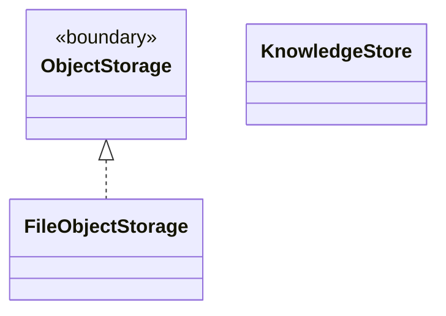

# src/logic/knowledge/storage 架构

## 设计意图

把知识规则接到本机文件，维护快照、预览缓存和可恢复事务。KnowledgeStore 组织物理提交，FileObjectStorage 提供对象规划所需的目录与缓存能力。

## 主要组成

| 组成 | 定位 |
| --- | --- |
| [KnowledgeStore](knowledge-store.ts) | 本机知识存储，承担初始化、快照、预览、串行事务、索引写入和崩溃恢复。 |
| [FileObjectStorage](object-storage.ts) | 对象预览缓存、目录存在性检查和提交后空目录清理的本机实现。 |

<!-- architecture:generated:start -->

## 架构关系

外部继承／实现边界：[ObjectStorage](../rules/object-storage.ts)。

[上层设计](../ARCHITECTURE.md)

<!-- architecture:generated:end -->
