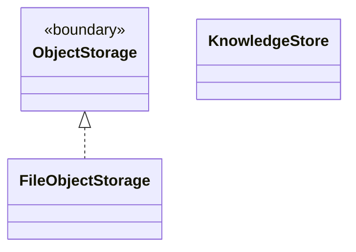

# src/logic/knowledge/storage 架构

## 设计意图

实现本机知识快照、预览计划与可恢复事务，集中维护物理文件的一致性。

`KnowledgeStore` 组织初始化、串行提交、索引写入与恢复，`FileObjectStorage` 管理预览缓存和目录能力。计划加载及来源日志核实保护原请求；对象规划经端口使用存储，物理层不反向决定角色、模块或治理策略。

## 主要组成

| 组成 | 定位 |
| --- | --- |
| [KnowledgeStore](knowledge-store.ts) | 本机知识存储，承担初始化、快照、预览、串行事务、索引写入和崩溃恢复。 |
| [FileObjectStorage](object-storage.ts) | 对象预览缓存、目录存在性检查和提交后空目录清理的本机实现。 |

<!-- architecture:generated:start -->

## 架构关系

外部继承／实现边界：[ObjectStorage](../rules/object-storage.ts)。

[上层设计](../ARCHITECTURE.md)

<!-- architecture:generated:end -->
