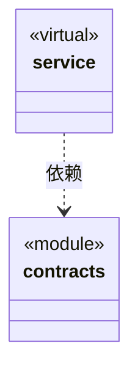

# src/logic/materials 架构

## 设计意图

聊天资料的身份、预览契约与采集保存服务；来源证明由业务持有，桥接仅传输受限数据。

## 主要组成

| 组成 | 定位 |
| --- | --- |
| [contracts](contracts.ts) | 资料快照的附件身份和预览数据契约。 |

<!-- architecture:generated:start -->

## 架构关系

标注为 `virtual` 的节点是直接子模块的虚拟类封装；内部设计沿下方入口阅读。

## 子模块

| 虚拟封装 | 整体职责 |
| --- | --- |
| [service](service/ARCHITECTURE.md) | 聊天输入、附件与引用材料的本机采集/持久化；保存的快照不自动证明当前来源有效。 |

[上层设计](../ARCHITECTURE.md)

<!-- architecture:generated:end -->
