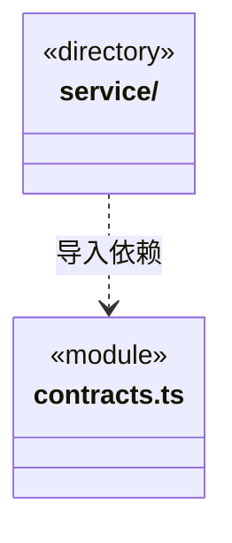

# src/logic/materials 架构

## 目录定位

聊天资料的身份、预览契约与采集保存服务；来源证明由业务持有，桥接仅传输受限数据。

本文描述当前实现。通过分析目录边界后维护的 [源码架构脚本](../../../scripts/source-architecture.mjs) 同步清单和声明；代码变更时仍须核对职责、关键成员与关系。

## 代码清单

| 文件 | 当前职责 |
| --- | --- |
| [contracts.ts](contracts.ts) | 资料快照的附件身份和预览数据契约。 |

## 架构类图

各图中的同名节点表示同一目录边界；跨组及完整直接依赖如下（无边不代表继承）：

- `service` → `contracts.ts`：导入。

## 子目录导航

- [service/](service/ARCHITECTURE.md)：聊天输入、附件与引用材料的本机采集/持久化；保存的快照不自动证明当前来源有效。

[返回上层](../ARCHITECTURE.md)。

每次修改本目录代码，同步维护文件头、关键契约说明及本图。未实现的治理、证据验收和自动编排能力不列入当前类图。
