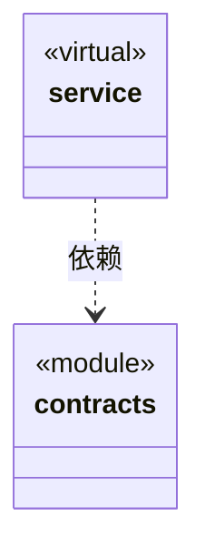

# src/logic/materials 架构

## 设计意图

管理聊天与目标补充所引用资料的身份和采集快照，使输入正文具有可核对来源。

本层契约表达附件身份与预览，`service` 负责显式导入、取消和持久化。Bridge 只传递受限数据；保存了快照不等于当前来源仍有效，也不表示获得业务执行授权。

## 主要组成

| 组成 | 定位 |
| --- | --- |
| [contracts](contracts.ts) | 资料快照的附件身份和预览数据契约。 |

## 现状与目标边界

当前 [contracts.ts](contracts.ts) 是父层纯数据协议，service 承担采集与持久化。目标是将公开协议归入明确契约封装，父层只描述组合；现有路径仍被输入与 Bridge 消费。迁移不能让这些纯数据消费者加载文件读取或导入服务，也不能改写旧附件快照身份。

<!-- architecture:generated:start -->

## 架构关系

标注为 `virtual` 的节点是直接子模块的虚拟类封装；内部设计沿下方入口阅读。

## 子模块

| 虚拟封装 | 整体职责 |
| --- | --- |
| [service](service/ARCHITECTURE.md) | 将用户明确选择的文件、目录、网页与仓库资料采集成有界的本机输入快照。 |

[上层设计](../ARCHITECTURE.md)

<!-- architecture:generated:end -->
