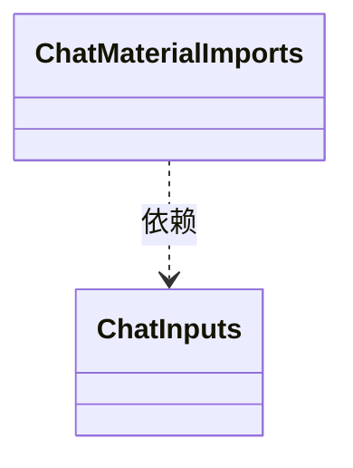

# src/logic/materials/service 架构

## 设计意图

将用户明确选择的文件、目录、网页与仓库资料采集成有界的本机输入快照。

`ChatInputs` 保存原资料，`ChatMaterialImports` 维护导入身份、工作区归属和取消，读取函数核实各来源。重开使用原快照与清单，不隐式重新导入改变原输入；工作区退役后旧代际不能继续提交资料。

## 主要组成

| 组成 | 定位 |
| --- | --- |
| [ChatInputs](chat-inputs.ts) | 将用户明确添加的文件、文件夹、链接、网页与链接器定义保存为本机对话输入快照。 |
| [ChatMaterialImports](chat-material-imports.ts) | 应用内显式资料导入的取消、工作区归属及真实资源仓库读取入口。 |

<!-- architecture:generated:start -->

## 架构关系

[上层设计](../ARCHITECTURE.md)

<!-- architecture:generated:end -->
