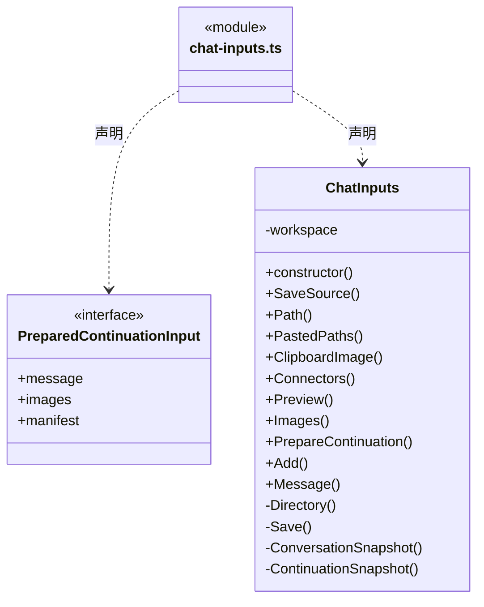
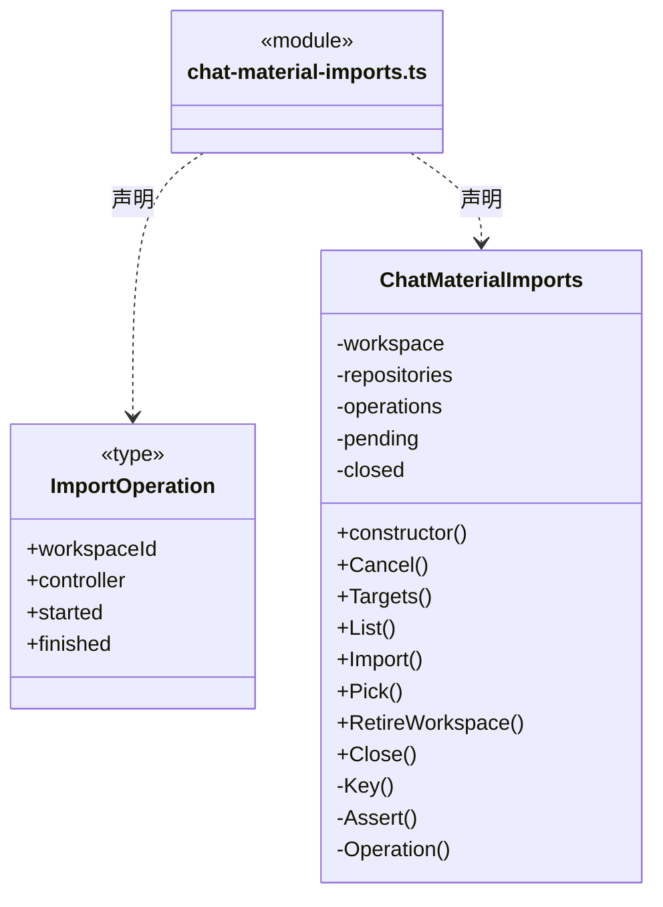
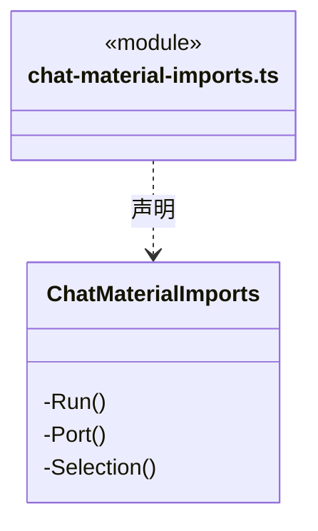
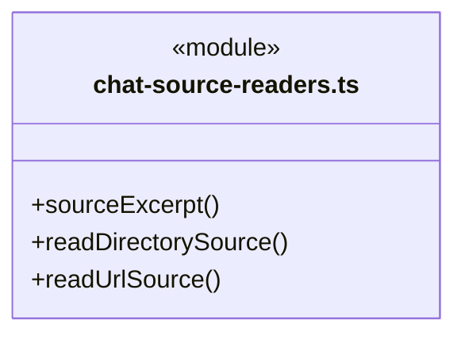
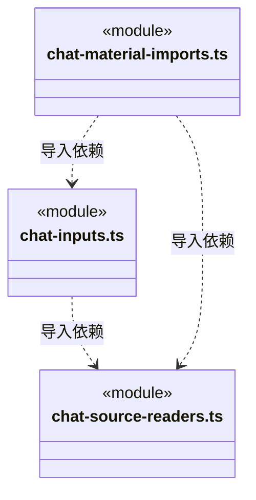

# src/logic/materials/service 架构

本目录只维护这一份说明。设计与契约直接编辑本文；文件清单、类图和导航由 [架构脚本](../../../../scripts/source-architecture.mjs) 更新，生成区域之外的人工说明会保留。

## 封装意图

聊天输入、附件与引用材料的本机采集/持久化；保存的快照不自动证明当前来源有效。

## 类与模块的设计意图

下表依据源码声明及文件头说明定位封装。字段表示该实例持有的状态或协作引用，不表示它拥有被引用服务的生命周期；实际资源责任和调用限制见下文契约及源码注释。

| 类／模块 | 实现形式与实例字段 | 封装依据 |
| --- | --- | --- |
| [ChatInputs](chat-inputs.ts) | 实例类；持有 `workspace` | 来源导入留在主进程；安全等待只从本工作区保存的严格版本快照读取一次，同字节准备正文、图片和清单，不再次访问源文件或网络。 |
| [ChatMaterialImports](chat-material-imports.ts) | 实例类；持有 `operations`、`pending`、`closed`、`workspace`、`repositories` | 应用持有一份；退出或工作区退役先撤销在途导入，不恢复网络操作或重放旧 importId。 |
| [chat-source-readers.ts](chat-source-readers.ts) | 函数／契约模块 | 字节/目录/摘录规则在 Main 决定，utility 负责有界流与 reader 取消；既不执行网页脚本，也不把首层清单称为完整目录。 |

## 接口设计契约

### materials 持久化契约

ChatMaterialImports.pending 使用 utility.InFlightOperations 跟踪原工作 Promise；导入 ID 去重、workspace 代际、closed、取消表与迟到选择拒绝仍由资料服务维护。close 先停止接单并撤销原控制器，再等待调用时在途快照；集合不决定保存位置、不接受半截结果或跨工作区重试。

网页资料的 reader 生命周期统一由 utility.readBoundedBytes 负责：累计字节上限为原 1 MiB，取消显式结束挂起读取，失败不返回前缀。URL/媒体类型/声明长度、15 秒期限、严格 UTF-8、摘录和来源 hash 仍由 chat-source-readers 决定；来源事实只基于完整原字节。清理仅请求取消，不等待不合作的底层 cancel Promise；不因此声称底层网络物理退出。取消/超限/错误类型或坏 UTF-8 仍不保存资料快照。

##### 剪贴板图片与路径快照

ChatInputs.ClipboardImage 只接受 PNG/JPEG/GIF/WebP、规范 base64、签名匹配且不超过5 MiB的原字节。source 保存唯一 clipboard URI 和原名称，note 保存采集时间；不伪造磁盘路径，文本不夹带base64。视觉输入、排队、等待补充共用已保存图片，仍受模型视觉能力和总20 MiB限制。

pastedPaths 只接受显式的绝对本地路径/file URL，拒绝相对、UNC/设备与 .cbim；先校验全选路径存在和种类，文件/目录仍复用原快照及目录首层200项限制。source 保留真实路径，正文为导入时快照，后续源文件变化不静默进入发送。preview 只按当前工作区UUID有界读取私有快照，并验证图片；不接受预览磁盘路径。路径/图片导入不自动发消息，孤立快照不自动进入模型。

##### 安全等待的附件快照

`ChatInputs.PrepareContinuation` 只读取当前工作区已保存的附件 ID，每份私有 JSON 只打开一次；读取前后核对普通文件身份、大小与时间，并受停止信号及有界读取限制。正文、图片和清单从同一份字节派生，不重新打开原始 source 路径或联网。仅文件/图片继续使用原 v1 清单；混入真实新来源使用严格 v2。跨工作区、缺失、损坏、无来源版本的旧非文件或超限附件在消费等待前明确拒绝；旧文本补充不生成空清单。

每次最多 12 项、私有快照单项 8 MiB、图片单项 5 MiB/合计 20 MiB、展开消息 512 KiB；超过总额度不截断后假装完整。清单仅保存 ID、名称、种类、字节数、哈希及新来源的紧凑 proof，不含原目录路径、正文或 base64。`snapshotHash` 绑定私有 JSON 原字节，`contentHash` 绑定这次送入模型的保存文本或解码图片；文件文本明确是可能截取的保存快照，不证明当前源文件全文。

`ChatMaterialImports` 是安全等待资料的显式导入/取消入口；普通聊天选择器/拖放和图片/路径粘贴另由 ChatInputs 保存快照。`importId` 在本次应用内只执行一次，取消先到仍保留墓碑；目录、网页或仓库读取迟到后不能返回给新目标。工作区退役先 abort，应用关闭排空真实操作；原生选择器不能强制关闭，但取消立即结束导入，之后返回的路径不读取。已原子写入后取消不冒称磁盘回滚，未被表单接收的孤立快照不会自动进入任何模型输入。每次应用最多 4096 个导入/取消标识，不自动淘汰后重放旧 ID。

目录由原生选择器指定真实路径，拒绝 `.cbim`，有界枚举首层最多 200 项及溢出哨兵，不递归、不读取文件正文或链接目标；同时受 64 KiB UTF-8 保存上限，真实部分性写入 proof。URL 指针零 fetch。网页仅一次 HTTP(S) GET，不使用登录凭据、不跟随重定向或执行脚本；15 秒超时/显式取消贯穿正文，完整响应最多 1 MiB，支持 UTF-8 `text/*` 或 `application/json`。完整有界原字节 hash 与实际文本摘录 hash 分开，摘录最多 64 KiB UTF-8，不切断字符；不是浏览器渲染、登录页面读取或公网 IP 隔离。

仓库资料仅通过已授权 `resource_repository_v1` 当前共享闭包读取，冻结连接代次和资源版本，一次实际 HTTP 返回后保存七类静态资源正文。proof 记录当时定义、授权 revision、仓库/资源身份、全文 hash/字节数和真实截取状态；落盘后交付前再次核实授权。正文不会安装、应用或执行。后续撤权/停止共享禁止新导入，不篡改已经保存的历史资料；安全等待准备只读取原快照，不重新联网、换源或复活授权。旧 connector 附件仍只是静态定义，不能冒充真实仓库资料。

##### 递归对话的材料边界

普通对话、排队消息及运行中插入的 message/images 入口都先有界读取当前工作区受管快照，检查 UUID 与内容身份、严格 UTF-8、文件/来源 Schema、来源 proof 和图片签名；不因没有 image 字段而跳过非图片校验。重复 ID、损坏证明和超过 512 KiB 的展开文本在发送前拒绝。保留旧 connector 入口的静态引用语义，不将其视为已采集的仓库来源。排队与运行中插入通过 prepareContinuation 冻结同一份文本、图片及附件清单；Conversation 保存排队清单并在首次发送前复核，Tasks 将清单绑定到输入哈希和持久接收记录。已接受回执的重复查询不再次读取附件或重放输入。旧 connector 静态引用不能作为此严格快照输入。

#### 共享算法调用边界

本目录通过 Core 公开入口调用 `ByteUtils.ReadBoundedBytes`。静态类只承载原算法；本目录继续决定字段、比较器、错误映射及资源生命周期。函数改为静态方法不改变原持久化字节或失败语义。

## 开闭边界

本目录的职责及允许协作由[封装意图](#封装意图)限定，输入输出、状态与失败语义以[接口设计契约](#接口设计契约)为准。扩展从已有公开入口及实际装配位置进入；没有明确可替换契约的部分按真实影响修改和验证，不预建未使用的基类或插件入口。

<!-- architecture:generated:start -->

## 文件清单

| 文件 | 形式 | 当前职责 |
| --- | --- | --- |
| [ARCHITECTURE.md](ARCHITECTURE.md) | 说明文档 | 本目录的文件清单、真实声明、依赖与子封装导航。 |
| [chat-inputs.ts](chat-inputs.ts) | 源码模块 | 将用户明确添加的文件、文件夹、链接、网页与链接器定义保存为本机对话输入快照。 |
| [chat-material-imports.ts](chat-material-imports.ts) | 源码模块 | 应用内显式资料导入的取消、工作区归属及真实资源仓库读取入口。 |
| [chat-source-readers.ts](chat-source-readers.ts) | 源码模块 | 桌面明确导入目录、URL 指针和网页时，生成有界文本及真实来源事实。 |

## 架构类图

成员标记：`+` 公开、`-` 私有、`#` 受保护、`$` 静态；构造函数单独列出。文档和资源仅在文件清单中导航，不作为代码节点。

### chat-inputs.ts

直接依赖：[../../../core/platform/node/files/index.ts](../../../core/platform/node/files/index.ts)、[../../../core/platform/node/serialization.ts](../../../core/platform/node/serialization.ts)、[../../../core/errors.ts](../../../core/errors.ts)、[../../tasks/rules/scope-continuation-attachments.ts](../../tasks/rules/scope-continuation-attachments.ts)、[../../execution/rules/types.ts](../../execution/rules/types.ts)、[../../knowledge/rules/ports.ts](../../knowledge/rules/ports.ts)、[../contracts.ts](../contracts.ts)、[../../tasks/rules/continuation-source-snapshot.ts](../../tasks/rules/continuation-source-snapshot.ts)、[chat-source-readers.ts](chat-source-readers.ts)。

### chat-material-imports.ts

成员 1/2（同名节点为同一声明，跨图合并阅读）。

成员 2/2（同名节点为同一声明，跨图合并阅读）。

直接依赖：[../../../core/utility/index.ts](../../../core/utility/index.ts)、[../../../core/errors.ts](../../../core/errors.ts)、[../../../core/platform/node/serialization.ts](../../../core/platform/node/serialization.ts)、[../../knowledge/rules/ports.ts](../../knowledge/rules/ports.ts)、[../../connectors/rules/repository-tools.ts](../../connectors/rules/repository-tools.ts)、[../../connectors/service/repository-connections.ts](../../connectors/service/repository-connections.ts)、[chat-inputs.ts](chat-inputs.ts)、[chat-source-readers.ts](chat-source-readers.ts)。

### chat-source-readers.ts

直接依赖：[../../../core/utility/index.ts](../../../core/utility/index.ts)、[../../../core/errors.ts](../../../core/errors.ts)、[../../../core/platform/node/serialization.ts](../../../core/platform/node/serialization.ts)、[../../tasks/rules/continuation-source-snapshot.ts](../../tasks/rules/continuation-source-snapshot.ts)。

### 本目录调用边界

## 子目录导航

无子目录。

[返回上层](../ARCHITECTURE.md)。

每次修改本目录代码，同步维护文件头、关键契约说明及本图。未实现的治理、证据验收和自动编排能力不列入当前类图。

<!-- architecture:generated:end -->
