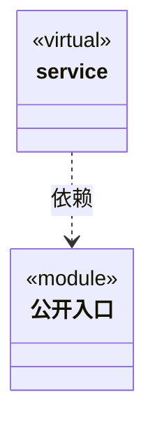

# src/logic/models 架构

## 设计意图

管理模型配置持久化与凭据，按 Framework 模型协议解析运行配置。

## 主要组成

| 组成 | 定位 |
| --- | --- |
| [公开入口](index.ts) | 供现有消费者访问公开协议。 |

<!-- architecture:generated:start -->

## 架构关系

标注为 `virtual` 的节点是直接子模块的虚拟类封装；内部设计沿下方入口阅读。

## 子模块

| 虚拟封装 | 整体职责 |
| --- | --- |
| [service](service/ARCHITECTURE.md) | 持久管理模型供应商配置，并在一致配置版本下解析运行连接与凭据。 |

[上层设计](../ARCHITECTURE.md)

<!-- architecture:generated:end -->
