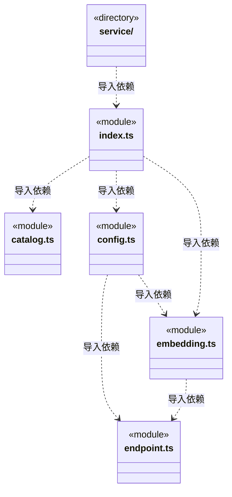
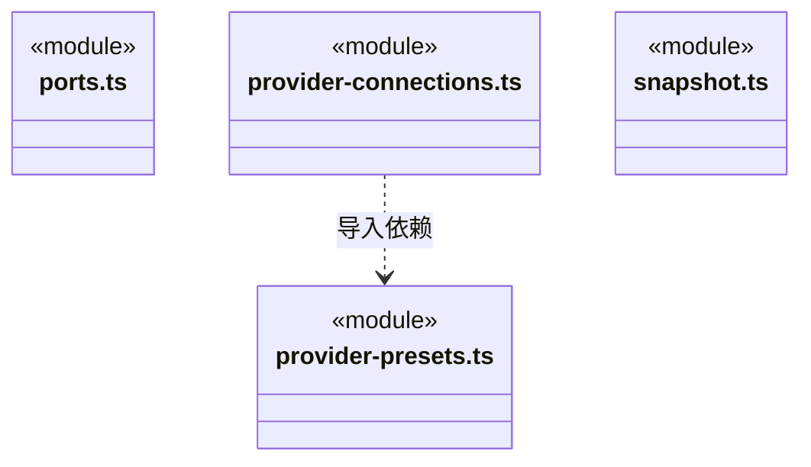
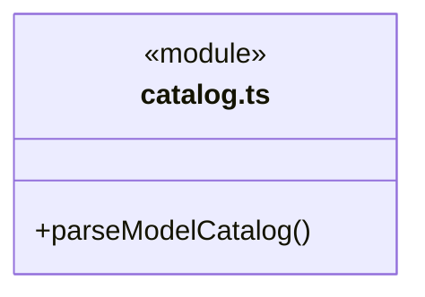
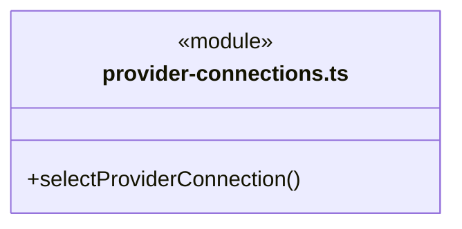
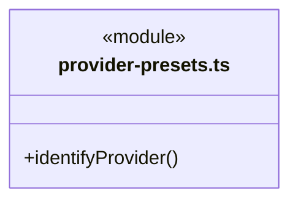
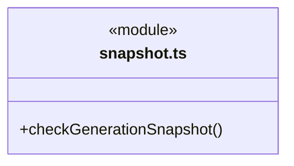

# src/logic/models 架构

## 目录定位

生成/向量模型目录、公开配置 Schema、供应商预设与通用协议接口选择；index.ts 是纯公共入口，不加载 Node 或服务。配置服务位于 service，请求预算归 logic/budget，主 Agent 设置归 logic/team/settings。

本文描述当前实现。通过分析目录边界后维护的 [源码架构脚本](../../../scripts/source-architecture.mjs) 同步清单和声明；代码变更时仍须核对职责、关键成员与关系。

## 代码清单

| 文件 | 当前职责 |
| --- | --- |
| [catalog.ts](catalog.ts) | 解析供应商模型目录的能力资料，供新增模型和显式同步容量使用。 |
| [config.ts](config.ts) | 定义自定义供应商的生成与向量模型目录，保持旧生成配置字节与字段缺省。 |
| [embedding.ts](embedding.ts) | 向量模型的独立配置、公开快照与凭据类型，不复用生成输出预算字段。 |
| [endpoint.ts](endpoint.ts) | 模型供应商端点的纯校验，供生成与向量连接共用。 |
| [index.ts](index.ts) | 模型目录和供应商连接的便携公共入口。 |
| [ports.ts](ports.ts) | 模型运行快照与凭据加解密端口。 |
| [provider-connections.ts](provider-connections.ts) | 供应商到协议需求的纯接口选择规则，供界面筛选、岗位采纳和实际启动共同使用。 |
| [provider-presets.ts](provider-presets.ts) | 模型设置与接口解析共用的官方供应商地址预设，属于模型配置的纯数据策略。 |
| [snapshot.ts](snapshot.ts) | 生成模型公开运行快照的纯校验，供引擎角色绑定与岗位历史共同使用。 |

## 架构类图

各图中的同名节点表示同一目录边界；跨组及完整直接依赖如下（无边不代表继承）：

- `config.ts` → `endpoint.ts`：导入。
- `config.ts` → `embedding.ts`：导入。
- `embedding.ts` → `endpoint.ts`：导入。
- `index.ts` → `catalog.ts`：导入。
- `index.ts` → `config.ts`：导入。
- `index.ts` → `provider-connections.ts`：导入。
- `index.ts` → `provider-presets.ts`：导入。
- `index.ts` → `ports.ts`：导入。
- `index.ts` → `embedding.ts`：导入。
- `index.ts` → `snapshot.ts`：导入。
- `ports.ts` → `config.ts`：导入。
- `ports.ts` → `embedding.ts`：导入。
- `provider-connections.ts` → `config.ts`：导入。
- `provider-connections.ts` → `provider-presets.ts`：导入。
- `provider-presets.ts` → `config.ts`：导入。
- `service` → `index.ts`：导入。

### catalog.ts 公开入口

### provider-connections.ts 公开入口

### provider-presets.ts 公开入口

### snapshot.ts 公开入口

## 子目录导航

- [service/](service/ARCHITECTURE.md)：LlmProfiles 配置持久化、生成/向量操作公开快照、受控锁内原子选型与延迟解密；index.ts 仅向宿主提供服务，平台加密由端口注入。

[返回上层](../ARCHITECTURE.md)。

每次修改本目录代码，同步维护文件头、关键契约说明及本图。未实现的治理、证据验收和自动编排能力不列入当前类图。

## 设计契约 v1 与落地范围

以下内容区分已接通能力与后续设计；以各节的实现状态为准，不将目标图当作现状图。维护源：[CONTRACT.md](CONTRACT.md)；生成类图时同步附加，勿直接修改本附录。

# 模型目录与选型

`index.ts` 是不加载 Node、Electron 或服务的纯公共入口。目录解析、配置 Schema、供应商预设和通用协议接口选择归本模块；配置持久化、联网与凭据解析归 [service](service/CONTRACT.md)。请求预算端口归 [budget/rules](../budget/rules/CONTRACT.md)，主 Agent 设置归 [team/settings](../team/settings/CONTRACT.md)，两者不由模型目录持有。

## 不变量

- 引擎身份、静态目录和引擎兼容策略归 [engines](../engines/CONTRACT.md)，本模块及 service 不导入引擎模块。旧 definition.engine 只保留冻结的三值读取范围，不决定实际执行，也不随新引擎扩展。AgentModelSelection 归 team/rules/agent-runtime。
- selectProviderConnection 接收 supportedApis 与可选 fallbackApi，优先使用兼容的主接口，其次显式接口，最后精确匹配官方 HTTPS 预设。显式型号限制不可通过预设绕过；autoDetect=false 禁止自动补充。不转换型号、协议或失败后重试。
- 目录解析保留供应商真实容量；未知能力不填造默认容量。公开配置不包含密文或明文凭据；ResolvedLlm 是仅供可信执行侧使用的类型，桥接出口不重导出它。
- 运行快照只冻结选中的 api/baseUrl，不携带候选接口；通用 ResolvedLlm 不携带 engine；执行快照由引擎层组合 ResolvedEngineModel，历史字段缺省及 Pi 快照字节保持原语义。

## 公共入口与消费边界

Logic 的规则、引擎、编排与 Bridge 消费模型规则时使用 index.ts。配置服务通过 service/index.ts 向已登记的 Logic 服务、应用装配及 Bridge 服务端公开；规则入口不得反向加载服务，调用方不得跨边界直达实现。

`bridge/contracts/models.ts` 暂时保留既有纯规则的具名重导出，前端通过该契约使用模型定义及供应商预设；引擎预览与 Agent 选型分别从 engines.ts、agent-settings.ts 消费；没有开放其他 Bridge 文件任意导入 Logic 模型实现，也没有把业务规则归入 Core。这是保留现有同步草稿预览的迁移兼容边界，不代表 Bridge DTO 解耦已经完成。若后续移除该重导出，必须一起替换预览与公开数据消费者，才能删除该精确许可。

修改供应商地址从 provider-presets.ts 入手，修改接口优先级从 provider-connections.ts 入手，修改能力解析从 catalog.ts 入手。规则与服务分开测试，前后端共同选型及历史快照用契约测试保留。

## 生成与向量操作

生成模型仍使用 models/defaultModel；embedding 单独声明 openai-embeddings 端点及向量型号，只含输入 token 上限、维度和可选输入价格，不伪填生成输出字段。向量接口不能从生成协议或品牌猜测。只有向量模型的供应商允许 models=[]、defaultModel=""，但必须至少有一个启用的向量模型；通用生成 resolve 对它明确拒绝，不隐式挑选向量型号。旧供应商缺省 embedding 时不补字段。

同供应商可共用已保存凭据；新建或改变向量端点需重新输入 Key，修改型号/维度/价格不复制凭据。运行生成快照不携带 embedding 配置。端点限制由 endpoint.ts 统一提供，操作字段由 config.ts 与 embedding.ts 分别拥有。

### 公开操作快照

snapshot.ts 持有生成模型的公开历史快照字段和容量约束，embedding.ts 持有向量快照。引擎、岗位可组合它们，但模型模块不依赖引擎或 Team。生成快照保留原字段顺序和历史端点校验，不在旧记录中追加操作类型或引擎身份。
